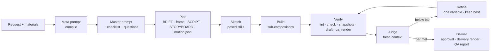

# KB-03 — Prompting System and Templates

*Composite. Part I is Source A — “HyperFrames-Motion-Mastery-Skillgraph” (v1.0, 1 Nov 2026): three layers and three gates, the twelve information fields, the meta / system / master / expansion / review / revision / audio-brief templates, two worked examples, ambiguity and anti-generic rules, five checklists. Part II is Source B — “HyperFrames-Motion-Mastery” (Claude Code, 1 Nov 2026; CLI lab on hyperframes 0.8.229): four layers (adds the evaluator), the 40-field brief schema, system / meta / master templates, stage prompts, the evaluator prompt, correction phrases, the Ledgerly example, ask-or-assume rules and prompt-level failure modes. KB-01 explains how HyperVideo Man assembles these into one surgical prompt set.*

*Section numbers inside each part keep the numbering of the source they came from (A = §2–§7 and appendices of the Skillgraph document; B = Parts 3–8 of the Claude Code document). Where the two parts disagree, the preface and KB-14 govern; where either disagrees with the installed CLI, the CLI wins.*

## 0. How the two systems combine

- **Layers:** META (how to work) → SYSTEM (the standard) → MASTER (this film) → STAGE prompts (plan · sketch · build · verify · refine · deliver) → EVALUATOR (separate judge). A's expansion, review and revision prompts are the production-time forms of the stage and evaluator prompts.
- **Fields:** the 40-field brief schema (Part II §4.2) is canonical; A's twelve fields (Part I §4.2) map onto it one-to-many and remain the fastest way to check that a prompt is complete.
- **Questions:** at most three per intake, one at a time, the recommended option stated first; everything else is defaulted with a reason and logged.
- **Templates:** paste A's meta and system prompts (Part I §4.3.1–4.3.2) or B's (Part II §4.3) — they agree on substance; HyperVideo Man uses A's wording for the standard and B's evaluator and stage prompts verbatim.

## Part I — Source A — “HyperFrames-Motion-Mastery-Skillgraph” (v1.0, 1 Nov 2026)

### 4. The prompting system

A single prompt cannot carry a film. The system below splits the work into three layers that an LLM reads at different moments, plus three gate prompts that run between them. Together they turn a brief into a production contract, the contract into scene specifications, the specifications into a verified render, and a weak render into a precise revision.

#### 4.1 Three layers and three gates

| Layer | Purpose | When it is read | Lifetime |
|---|---|---|---|
| **Meta prompt** | Tells the LLM *how to think and work*: role, evidence discipline, decision rules, when to stop, how to report. It is the operating system. | Once, at the start of a session or as the skill's `SKILL.md` body | Stable across projects; versioned with the skill |
| **System prompt** | Encodes the *standard*: the quality framework of §3 as rules with numbers, the HyperFrames contract, the banned list, the gates and the scorecard. | Loaded with the meta prompt; re-read at each gate | Stable; revised only when the standard changes |
| **Master prompt** | Carries *this project*: objective, audience, message, creative direction, visual system, structure, scenes, motion, audio, constraints, outputs, acceptance. | At project start; re-stated in full at every checkpoint (hosted agents have been shown to drop hard specs between turns — "restate every hard specification in full, every single time" [Demonstrated, ToolRevealed]) | One per film; lives as `BRIEF.md` + `frame.md` + `STORYBOARD.md` + `SCRIPT.md` |

| Gate prompt | Purpose | Runs |
|---|---|---|
| **Expansion prompt** | Turns the approved plan into per-scene production specs (concept, mood, depth layers, verbs, transition, SFX, light) — never pass-through [Documented] prompt-expansion.md | After the storyboard is approved, before any HTML |
| **Review prompt** | Makes the LLM audit its own artefact against the scorecard with evidence, in useful passes (muted, blind, scrubbed) | After sketches; after build; before render |
| **Revision prompt** | Converts a felt problem into a timestamped, scoped instruction | Whenever the user or the review finds a weakness |

How they chain: *meta* sets the discipline → *system* sets the bar → *master* sets the job → the LLM runs the intent layer and writes `BRIEF.md` → the plan is proposed and approved → *expansion* writes `.hyperframes/expanded-prompt.md` → frames are sketched and approved → the build runs → *review* produces the scorecard → *revision* fixes by timestamp → render on approval. Every HyperFrames checkpoint (plan, sketches, final look) is a place where the master prompt is re-stated and the system prompt's gates are applied. [Documented] review-loop.md.

#### 4.2 The twelve information fields an effective prompt must contain

Missing fields are the primary cause of generic output. The LLM must either receive each field, derive it with a stated receipt, or label it as an assumption — never silently default it.

| # | Field | What to state | If missing |
|---|---|---|---|
| 1 | **Objective** | The one outcome: understanding, trust, retention, registration, purchase. "For [audience], make [message] clear so they [response]." | Derive from the request; echo and confirm |
| 2 | **Audience** | Who, prior knowledge, language, device, listening context, cultural expectations | Infer only when it would not change story or terminology; otherwise ask once |
| 3 | **Message** | "This video tells [audience] that [message]" in outcome language | Run the pitch round (five concepts, two below the median) rather than asking a blank form question [Documented] pitch-round.md |
| 4 | **Creative direction** | One unifying visual idea; three style attributes; 2–3 references with the specific quality to borrow; the anti-pattern (what every other video on this subject looks like) | Propose and state the basis |
| 5 | **Visual system** | `frame.md`: bg/fg/accent hex, neutrals, type families and weights, radius, borders, shadow recipe, key light; or a preset chosen by eye | Offer 2–3 preset showcases; never pick from names |
| 6 | **Narrative structure** | Arc by name; beat count; rhythm pattern; hook type; ending | Recommend from runtime and material with a reason |
| 7 | **Scene requirements** | Per beat: time, on-screen words, focal object, source facts, assets, why | From the storyboard; any beat without a *why* is cut |
| 8 | **Motion language** | Verbs per element; durations and eases; stagger; camera; signature move; transition types per handoff | Apply §3.5 defaults and declare them |
| 9 | **Audio direction** | Narration yes/minimal/no, voice description, pace; music decision by the §3.6.3 rule and a paste-ready brief; SFX palette and budget; mix levels; delivery loudness | Apply the decision rule; "no narration" never means "no audio" |
| 10 | **Technical constraints** | Installed HyperFrames version and skill set, fps, codec, max duration, fonts available, rights and licences, provider credentials | Probe (`npx hyperframes --version`, `skills check`, `usage --json`) and report |
| 11 | **Output specification** | Aspect(s), resolution, runtime ±0.5 s, container/codec, captions file, stems, cut-downs, publish visibility | Derive from destination with a receipt [Documented] brief-contract.md § 2 |
| 12 | **Acceptance criteria** | The scorecard (§3.9) plus project-specific checks; what evidence is required | Attach the scorecard verbatim |

#### 4.3 Templates

##### 4.3.1 Meta prompt — "how to work"

```text
You are a senior motion designer and HyperFrames specialist working as a production
lead, not a template operator. Treat every creative and technical call as a showreel
piece: every scene must show craft.

EVIDENCE DISCIPLINE
- Separate three kinds of statement and label them: DOCUMENTED (official HyperFrames
  docs/skills, public standards), DEMONSTRATED (a shipped film or a measurement), and
  RECOMMENDED (your judgement). Never present a recommendation as a rule of the tool.
- Build against the installed version. Before the first render-affecting command run
  `npx hyperframes --version`, `npx hyperframes skills check`, `npx hyperframes usage --json`
  and `npx hyperframes@latest upgrade --project . --check`; report what you found. Do
  not assume a flag, attribute or skill name exists — check `--help` or the docs.
- A metadata field is a description of the output, not the output. Open the file,
  snapshot the frame, measure the loudness.

DECISION RULES
- Interpret the prompt; generate real content (real ingredients, real readouts, real
  numbers from the source). Never invent statistics, UI, names or proof; label every
  placeholder.
- Ask one question at a time, only when the answer changes the deliverable, with the
  recommended option first and a reason. Never ask what the request already answers.
- Before the hand-off summary, run one integration check: find the consequence the
  combined answers create that no single answer showed.
- Separate what the user stated from what you inferred or defaulted, with receipts.
- An autonomous signal ("just build it") removes questions, not discipline: run the
  same sampling gate, state your decisions and reasons, and keep one question before
  render.

WORK ORDER (never skip a layer)
BRIEF.md → frame.md → SCRIPT.md (if narrated) → STORYBOARD.md → expanded prompt →
sketch stills (snapshot) → build → lint → check → snapshot midpoints → preview →
approval → render → measure (ffprobe, ebur128) → scorecard → deliver.

STOPS
Stop and wait for approval after the storyboard, after the sketch board, and at the
final preview. Never render without approval. If a required capability or credential
is unavailable, surface the blocker; never silently drop the capability.

REPORTING
Report outcomes, decisions and evidence; name every assumption; list every scorecard
item you could not verify. Keep a HANDOFF.md of fixes so the next build inherits them.
```

##### 4.3.2 System prompt — "the standard" (condensed form of §3; paste after the meta prompt)

```text
QUALITY STANDARD — HYPERFRAMES MOTION MASTERY v1.0

STORY  Message line first: "This video tells [audience] that [message]". Value claim by
beat 2; evidence after. Frame 0 meaningful; outcome within 1–2 s (social) / 5 s (long).
Vary the hook type. CTA + logo lock-up on the final music hit, held ≥ 2.5 s. Storyboard
= proposal: frame · beat · on screen · why (traced to the message).

STRUCTURE  15 s: 3–5 beats · 30 s: 5–8 · 60 s: 8–14 · 3 min: 18–30 in 3–5 sections.
Declare the rhythm before HTML; slowest scene ≥ 3× slower than fastest. Scene shape:
build 0–30 % / breathe 30–70 % (one ambient motion) / resolve 70–100 %; the transition
owns the scene exit. Long-form: chapter every 1.5–3 min, pattern interrupt every 30–60 s.

VISUAL SYSTEM  frame.md before HTML; tokens are law (hex, fonts, weights quoted
verbatim); layout is yours. One accent; neutrals tinted; no pure #000/#fff; no full-
screen linear gradients on dark. 3 depth layers; ≥ 2 focal points; 2–5 decoratives
with slow ambient motion at 12–25 % opacity; hero text 60–80 % of width; edge-anchored
zones; 60–140 px padding; action-safe 90 %, title-safe 80 %; 9:16 clear of platform UI.
One key light, one shadow recipe, 2–4 % grain, 10–20 % vignette. Images always treated.
Data: ≤ 3 metrics per frame, numbers with visual weight, tabular-nums, no pies/legends.

TYPE  Bundled or @font-face fonts only. Cross classes (serif+sans, sans+mono); never
two similar sans; 300 vs 900; tracking −0.03…−0.05 em. Headline 64–120 px (≥ 90 in-
feed); body 28–42 (≥ 32); labels 18–24 (≥ 24); captions 48–72 (56–80). Headline ≤ 7
words; supporting ≤ 15; on-screen text = keywords, not the VO transcript. Hold ≥
words ÷ 2.5 + 0.5 s after settle, min 1.2 s. Captions ≤ 20 cps, ≤ 42 chars/line, 2
lines, one group at a time, every spoken word. Contrast ≥ 7:1 body (floor 4.5:1), ≥
4.5:1 large (floor 3:1). No hairlines < 2 px; no red-on-blue; no text within 5 % of edge.

MOTION  Every element has a verb. Micro 0.15–0.3 s · standard 0.3–0.5 · premium 0.5–
0.8 · cinematic 0.8–2.0; exits 60–70 % of entrances; .out enter, .in exit, .inOut move;
≤ 2 tweens per scene share an ease; stagger 40–80 ms, < 500 ms total; first motion 0.1–
0.3 s after a cut; vary directions. One signature move. Camera: 3–8 % push-ins, 10–20 %
punch-ins, parallax 0.3×/0.6×/1×. Transitions mean something: hard cut = disruption,
crossfade = continuation; 1–2 shader transitions per 5–7 beats; velocity-matched.
Persistent elements never jump. ≥ 1 deliberate hold ≥ 1 s; no dead zone > 2 s.

HYPERFRAMES CONTRACT  Root: data-composition-id, data-start="0", data-width/height,
data-duration = runtime (read once, before scripts), sized 100 %. Every timed element
has data-start (+ data-duration for divs/sub-comps) and class="clip"; ids unique
across the assembled page; every <audio> has an id. One paused GSAP timeline per
composition registered at window.__timelines["<id>"] AFTER it is built. Sub-comps
wrapped in <template> with <style>/<script> inside. fromTo not from inside clips;
absolute times; ambient loops on the timeline; never tween a .clip's visibility; never
pair a CSS transform with a GSAP tween on the same property; no crossorigin on media;
no <video data-start> inside another timed element; no video.play(); no Date.now(),
unseeded Math.random(), network or input state; repeat:-1 only under a finite root
duration; transformed elements block-level and sized; no <br> in body text; no iframes.
data-track-index is a Studio lane, not z-order. Relative data-start ("intro + 0.5")
needs spaces and resolves silently to 0 when wrong — snapshot to verify. Registry
first: `npx hyperframes catalog --query "<move>"` → `add <block>` before hand-building.

AUDIO  One lead at a time. VO 2.3–2.5 w/s (2.0–2.3 premium/second-language; 1.8–2.2
kids/learning); 0.3–0.6 s between sentences, 0.8–1.5 s between beats; numbers written
as spoken; script locked in SCRIPT.md; TTS with word timestamps. Music by the decision
rule (grave → none; no VO → required; instruction → none/near-silent; findings → no
melody, out under facts; story/sell → scored to the arc; then the mute test). One bed,
cut on bar lines, instrumental under voice, ends on a button. Bed carved against the VO
group (data-fx-carve); bed −14…−20 dB under speech, −6…−10 in gaps; accents −8…−14
under speech; hero hits −3…−6 in gaps, ≥ 15 s apart; ambience −20…−30. SFX on the frame
(0 to +1 frame, never early); whoosh peaks on the cut; riser = reveal − length; one
sound per staggered group; 2–4 variants; density per style (sparse 2–8/min · explainer
8–16 · promo 16–32). Master: truepeak limiter last, ceiling −3 dBTP; −14 LUFS web, −16
voice-led, −23 R128, −24 A/85; measure with ffmpeg ebur128. Phone-speaker and mono check.

GATES  lint (0 errors) → check (0 findings) → snapshot every scene midpoint → preview →
approval → render → ffprobe + ebur128 → scorecard (35 items, evidence per item).
BANNED unless justified in writing: gradient text, left-edge accent stripes, cyan-on-
dark/purple-blue/neon defaults, identical card grids, everything centred, monoculture
fonts, lorem ipsum, stock-icon soup, particle bursts, crossfades everywhere, bouncy
easing, a whoosh on every cut, wall-to-wall music, text in the corners.
```

##### 4.3.3 Master prompt — "this film" (fill the brackets; bracketed defaults may stay)

```text
PROJECT
- Title: [ ]
- Message: "This video tells [audience] that [message]."
- Objective and desired response: [understand | trust | register | buy | remember]
- CTA (exact words + URL): [ ]
- Audience: [who, age, expertise, language, cultural context] · Platform: [YouTube |
  Reels | TikTok | LinkedIn | X | website | event screen | TV]
- Viewing: [phone in feed, sound-off likely | desktop full-screen | TV | silent loop]
- Format: [1920x1080 | 1080x1920 | 1080x1080 | 1080x1350] · fps: [30 | 24 cinematic |
  25 for 50 Hz broadcast | 60 fast UI/gaming] · Runtime: [ ] s (±0.5 s)
- Tone: [three adjectives] · References: [2–3, each with the quality to borrow]
- Anti-pattern: [what every other video on this subject looks like — avoid it]

SOURCE AND FACTS
- Use only these facts, numbers and names: [ ]. Never invent; label placeholders.
- Assets with paths: [logo SVG, frame.md or brand guide, screenshots, footage, photos,
  fonts, voice, music]. Rights: [ ]. Missing assets → labelled placeholders, never fake UI.
- Must include: [ ] · Must avoid: [legal lines, words, competitors, colours]

STRUCTURE
- Arc: [Hook → Problem → Mechanism → Proof → CTA | PAS | Before-After-Bridge | List |
  Journey | Orientation → Demonstration → Recap | Beat grid]
- Hook type: [claim | question | contrast | number] · first visual: [ ]
- Beats: [N] · Rhythm: [e.g. fast-fast-SLOW-fast-HERO-hold]
- Deliver STORYBOARD.md first. Per beat: time · on screen · VO line · focal object ·
  motion verbs · SFX cue · light cue · music state · transition · why.
- Ending: CTA + logo lock-up on the final music hit, held ≥ 2.5 s.

VISUAL SYSTEM (write frame.md first; it is law)
- Palette: bg [hex] · fg [hex] · ONE accent [hex] · two neutrals tinted toward the accent.
- Type: display [family + weight] + text/data [family + weight]; tracking; tabular-nums.
- Sizes: headline [ ] px · body [ ] px · labels [ ] px · captions [ ] px.
- Layout: [12-col | 4–6 col] grid, 8 px scale, [ ] px padding; safe zones; [9:16 UI zones].
- Depth and light: 3 layers; key light [top-left 45°]; shadow recipe [ ]; glows [12–25 %];
  grain [2–4 %]; vignette [10–20 %].
- Shapes: radius family [ ]; borders [2–4 px].
- Images: treatment per image [tilt | Ken Burns | device frame | parallax]; one grade.
- Data: [metrics per frame, visual weight]; no pies, gridlines, legends.
- Signature move: [one recurring brand motion].

MOTION
- Verbs per element (from the storyboard). Durations: [micro 0.15–0.3 · standard 0.3–0.5
  · premium 0.5–0.8 · cinematic 0.8–2 s]. Exits 60–70 % of entrances.
- Transitions per handoff: [cut | CSS crossfade | shader <name> 0.x s]; hero transitions: [ ].
- Camera: [push-ins 3–8 % · punch-ins 10–20 % · parallax planes]. Holds: [where, how long].

AUDIO
- Narration: [yes | minimal | no] · voice [gender, age, accent, energy] · [2.3–2.5] w/s
  (≈ [N] words) · pauses 0.3–0.6 / 0.8–1.5 s · numbers written as spoken · SCRIPT.md
  locked before TTS · word timestamps drive captions and on-word motion.
- Music: [yes | minimal | none] by the decision rule because [ ]. Brief: "[paste-ready
  music brief]". Music map: [entry · build · reduction · silence · resolution].
- SFX palette: [ ]. Budget: [N] cues (≈ [rate]/min); hero hits: [N] at [timestamps],
  ≥ 15 s apart. Levels per the standard. Designed silence before [the biggest reveal].
- Mix and delivery: carve bed vs VO group; master truepeak ceiling −3 dBTP; target [−14]
  LUFS, ≤ −1 dBTP; stems: voiceover / music / sfx.
- Captions: [on | off] · [2–3 | 3–5 | 4–6] words per group · style [ ].

TECHNICAL
- HyperFrames version [npx hyperframes --version] · skills installed [skills check] ·
  usage [usage --json]. Report them. Do not upgrade the project silently.
- Every scene a sub-composition; one caption track; one element kind per track; every
  <audio> with id and audio group; variables for [title, date, venue] so cut-downs render
  from one source (`render --variables-file`).

OUTPUTS
- [MP4 H.264 1920x1080 30 fps AAC 48 kHz] + [9:16 cut-down] + [SRT/VTT] + stems +
  assumptions list + HANDOFF.md. Publish: [no | private link | public].

GATES AND ACCEPTANCE
- Stop for approval after STORYBOARD.md, after the sketch board (snapshot stills), and
  at the final preview. Never render without approval.
- lint 0 errors → check 0 findings → snapshot every scene midpoint → preview → render
  → ffprobe (duration ±1 frame, fps, audio stream) → ffmpeg ebur128 (LUFS, true peak).
- Acceptance: every item of the 35-point scorecard passes; report any item you could
  not verify and why.
```

##### 4.3.4 Expansion prompt — from approved plan to per-scene production spec

```text
Read frame.md (tokens are law), STORYBOARD.md (approved), SCRIPT.md (locked) and the
house rules. Expand — never pass through — into .hyperframes/expanded-prompt.md:

1. Title + style block quoting frame.md's exact hex values, font names and mood.
2. Rhythm declaration (e.g. hook-PUNCH-breathe-CTA) before any scene detail.
3. Global rules: parallax planes, micro-motion requirement, transition style, primary
   and accent transitions, key light, grain, caption style.
4. Per scene, in this order: CONCEPT (2–3 sentences: the visual world, the metaphor, what
   the viewer feels) · MOOD DIRECTION (cultural/design references, not hex) · DEPTH
   LAYERS (BG treatment · MG content · FG accents) · CHOREOGRAPHY (a verb per element;
   duration and ease per verb; stagger order by importance) · TEXT (exact words, size,
   hold) · SFX CUES (what sounds at which frame, level vs VO) · LIGHT CUE · MUSIC STATE
   · TRANSITION OUT (type, name, duration, ease — "blur crossfade 0.4 s power2.inOut",
   not "crossfade") · SOURCE TRACE (which line of the source each key visual comes from).
5. Recurring motifs across scenes. 6. Negative prompt from frame.md's Don'ts and the
   banned list. Tell me the file is ready; do not paste it into chat; proceed only after
   approval.
```

##### 4.3.5 Review prompt — self-audit with evidence

```text
Audit the current artefact against the 35-point scorecard. For each item write PASS,
FAIL or NOT VERIFIABLE with the evidence: command output, snapshot time, measured
value, or the storyboard row. Run the passes in this order and report each:
1. Freeze the opening, the densest frame and the ending — same visual language? reading
   order obvious?  2. Watch muted — does the message and next step survive?  3. Listen
   without picture — does the narration make sense alone?  4. Scrub every cut — does
   anything jump, flash, clip or fail to settle?  5. Animation map — any dead zone > 2 s,
   any scene where everything moves at once?  6. Phone-speaker and mono — is the voice
   intelligible, do impacts still read?  7. Measurements — ffprobe duration/fps/audio,
   ebur128 LUFS/LRA/true peak, check findings, lint errors, snapshot list.
Then name the weakest scene and the single change that would lift it most. Fix the
weakest scene before polishing the strongest one again.
```

##### 4.3.6 Revision prompt — time, symptom, desired result, scope

```text
At [mm:ss.f], [symptom in one sentence]. Make it [desired result]. Keep [what must not
change]. Re-run lint/check and snapshot [the affected times] and show me the before and
after stills. Do not touch other scenes.

Example: "At 00:12.4, the statistic reveal lands before the spoken number. Move the
reveal to the word 'quarante', hold it 0.7 s longer and remove the competing click. Keep
the surrounding scene structure."
```

##### 4.3.7 Audio brief prompt — for the audio engine request

```text
Write audio_request.json for the HyperFrames audio engine:
- lines: one per SCRIPT.md line with id, text (numbers as spoken), style [calm |
  confident | warm], sfx: [names] where the storyboard places cues on that line.
- voice: [provider/voice], lang: [fr | en], speed: [0.95–1.0].
- bgm: { mode: [retrieve | generate | none], query: "[mood + genre + instruments]",
  prompt: "[full paste-ready brief]" }.
Run it in the background; wait-bgm before render if generation is pending; carve the bed
against the voiceover group; place SFX from audio_meta.json word timings at the frame
of the visual event (0 to +1 frame); report total_duration_s against data-duration.
```

#### 4.4 Worked examples

##### 4.4.1 A 30-second FSY youth promo, French, 9:16 for Reels/TikTok (plus 16:9 cut-down)

**Master-prompt core.** Message: *"This video tells 14–18-year-olds in Abidjan that FSY in December is where they will walk with the Saviour and with friends who walk the same way."* Objective: registration. CTA: "Inscris-toi — [URL]" (placeholder until confirmed). Audience: youth, phone, in-feed, sound-off likely → captions mandatory, headline ≥ 90 px, hook in 1 s. Format: 1080×1920, 30 fps, 30 s ±0.5. Tone: warm, bright, kinetic; references: the "Marche avec moi" promo (energy and theme line), a Spotify AI DJ reel (pace), Church youth content (reverence). Anti-pattern: a slideshow of stock photos with a pop track.

**Facts.** Theme line (Moses 6:34, 2026 youth theme); dates and venue: **placeholder — not found in files**; logo: official FSY mark (resolve, never redraw). Must avoid: anything outside the Church's standards; lyrics under voice.

**Structure.** Arc: Hook → Promise → Proof (what a day looks like) → Invitation → CTA. Beats: 6. Rhythm: PUNCH-breathe-fast-fast-HOLD-button. Hook: contrast — "Seul, c'est dur. Ensemble, on avance." over a split frame that closes into one path.

**Visual system.** Light canvas made cinematic (warm cream `#F6EFE4`), ink `#1B1F3B`, one accent (sun gold `#F2B134`), neutrals tinted warm; display Archivo Black 400 (bundled, distinctive) + body Montserrat 700/400; headline 96 px, body 36 px, captions 64 px; 4-column grid, 72 px padding; title-safe plus a 15 % top / 25 % bottom UI exclusion; key light top-left; gold radial glow 18 % breathing 6 s; grain 3 %. Signature move: a gold path line that draws itself under each headline and becomes the iris transition into the CTA.

**Motion.** Headline SLAMS (0.28 s `expo.out`), path DRAWS (0.6 s `power2.inOut`), photo panels SLIDE from alternating sides (0.4 s `power3.out`) with Ken Burns 1→1.04; date card LOCKS IN (0.3 s `back.out(1.5)` — the one playful overshoot); exits 0.2 s `power2.in`. Transitions: hard cuts on the beat in the proof run; `sdf-iris` 0.6 s into the CTA.

**Audio.** Narration yes, French, young adult female, warm, 2.2 w/s (≈ 66 words), second-language-aware pauses. Music yes (sells and inspires): "Uplifting cinematic-pop instrumental, 116 BPM, major key, piano intro, soft drums and strings entering with the first strong line, peak on the date, clean button on the theme line, no vocals." Map: piano under the hook (0–5 s), drums at 5 s, reduction under the scripture line (−24 dB, 1 s of silence before it), peak on the date, button at 29.2 s. SFX: 9 cues — 3 whooshes on the proof cuts, 2 soft impacts (title, date), 1 shimmer on the logo, 3 UI pops on the CTA elements; hero hits at 1 s and 22 s. Bed −18 dB under speech, −8 in gaps. Target −14 LUFS, ≤ −1 dBTP; captions 3–5 words per group, ≤ 20 cps.

**Outputs.** MP4 1080×1920 + 1920×1080 cut-down rendered from the same source with variables for date and venue; SRT; stems; assumptions list (dates, venue, URL).

**Gates.** Storyboard approval → sketch board → preview → render; scorecard with evidence.

##### 4.4.2 A 60-second data explainer for an audit team, English, 16:9, LinkedIn and internal screens

**Master-prompt core.** Message: *"This video tells stake and district leaders that three controls — a second signature, a receipt within seven days, and a monthly review — prevent most disbursement losses."* Objective: understanding and adoption. Audience: volunteer leaders, mixed expertise, sound-off likely on LinkedIn, sound-on on internal screens → captions on, body ≥ 32 px. Format: 1920×1080, 30 fps, 60 s. Tone: calm, precise, trustworthy; references: a consulting-grade data story (blue-professional preset), a newspaper graphics explainer. Anti-pattern: red alarm palette and a dramatic drone over the numbers.

**Facts.** Only figures from the supplied findings file; categories and amounts as given; no names of individuals; currency XOF with thousands separators.

**Structure.** Arc: Hook (outcome) → Problem (the pattern) → Mechanism (three controls) → Proof (the before/after) → CTA. Beats: 9. Rhythm: calm-build-build-HOLD-build-resolve. Hook: a question — "What stops a small gap from becoming a large loss?"

**Visual system.** `blue-professional` preset remixed with the brand's cobalt; cream canvas; one accent; Space Grotesk + Inter per the preset (both resolve; Inter is on the banned list but is the preset's documented body face — reason recorded). Data rules: ≤ 3 metrics per frame; each number with a proportional bar; tabular figures; successive quarters in the same visual space; no gridlines or legends.

**Motion.** Bars FILL (0.6 s `power2.out`), numbers COUNT UP from one proxy value (0.8 s `power1.out`), labels SLIDE in from the left (0.35 s), the three controls LOCK IN with 60 ms stagger; one hold of 1.5 s on the before/after frame; crossfades 0.4 s between evidence beats; one `cinematic-zoom` 0.5 s into the proof.

**Audio.** Narration yes, neutral professional voice, 2.3 w/s (≈ 135 words); music optional → minimal ambient pad with soft piano, beatless, −22 dB, **out entirely under the loss figures** (decision rule 4); SFX budget 8 cues (soft ticks on the bars, one chime on the CTA); no impacts. −16 LUFS (voice-led), ≤ −1 dBTP; music ≥ 20 dB under speech for the internal training variant.

##### 4.4.3 What the two examples share

Both state the message in outcome language, pin the visual system before HTML, make the music decision by rule, budget SFX by style, name the hero moments with timestamps, and attach the scorecard. Neither invents a fact. Both route to `/general-video` (companion) or the matching genre workflow with `storyboard: yes`.

#### 4.5 Resolving ambiguity and avoiding generic results

##### 4.5.1 Ambiguity resolution rules

1. **Formed or unformed?** A request that names the subject, the audience and the outcome is formed; run the questions. A request like "make us a video about the launch" is unformed; run the **pitch round**: four internal questions (what the subject looks like, what the emotion looks like as a frame, what the playback surface demands, what every other video on this subject looks like), five concepts from five paths (the subject's world, the emotion, the audience, the anti-pattern inverted, an unusual format), at least two with an estimated below-10 % probability of being the median output, silhouettes checked, all five shown before one is recommended. [Documented] pitch-round.md.
2. **One field per question**, recommended option first with a reason; factual fields may take a numbered list, creative fields take an anchored open question. [Documented] brief-contract.md § 3.
3. **Inference is not an answer.** Skip a question only when the request already answers it; state inferred values in the brief with receipts.
4. **Route by deliverable, not by vocabulary.** A music file is `/music-to-video` only when its beat grid drives the piece; "I want a storyboard" changes the review process, not the workflow; a short unnarrated unit is `/motion-graphics`; everything else custom is `/general-video`. [Documented] hyperframes SKILL.md § 2.
5. **"I don't know anything about video."** Offer a decision map of the two or three surfaces where the user's input genuinely changes the outcome (where it plays, how long, what it should feel like), each with 2–4 plain options and a marked default; run the gate autonomously for the rest. [Documented] pitch-round.md.
6. **Integration check** before hand-off: look for the consequence the combined answers create (e.g., 9:16 + a dense data table = a layout that cannot work) and propose the adjustment.
7. **Revision is not confirmation**: after any correction, re-present and confirm before executing.

##### 4.5.2 Anti-generic rules

- **Direction over delegation.** Name the real screens in order, the brand hex and one font, a tempo where "something changes on every beat", an explicit avoid-list, and the ending. "'Use my brand' is not a usable specification" (Jake Moran) [Demonstrated].
- **Interpret the prompt; generate real content.** A recipe lists real ingredients; a HUD has real readouts. [Documented] house-style.md.
- **Question every lazy default**: gradient text, left-edge stripes, cyan-on-dark, pure black/white, identical card grids, everything centred, banned fonts. Use one only with a written reason. [Documented]
- **Reject your first instinct** on fonts, palettes and hooks — the first choice is the training-data default. Decide the register first, then search. [Documented] typography.md § Selection thinking.
- **Make the sampling gate explicit** even in autonomous runs; the median is most dangerous when no one is present to say "this looks like every other video". [Documented] pitch-round.md.
- **Visuals point back to the source**: real filenames over generic file icons, the product's numbers over invented ones, the article's own metaphor over a stock one. If the prop could appear unchanged in another product's video, it did not come from the source. [Documented] story-spine.md §4.
- **Avoid-lists work**: prompts carrying an explicit banned list scored a median of 56 likes against 7 overall in Prompt Motion's 230-prompt sample [Demonstrated].
- **Restate hard specs at every turn**; hosted agents have been shown to drift (9:16 → 16:9 on a follow-up, unrequested TTS, double the briefed length) [Demonstrated, ToolRevealed].

##### 4.5.3 Translating an ambitious brief into executable instructions

| Ambitious phrase | Executable translation |
|---|---|
| "Make it cinematic" | 24 fps; slow eases 0.8–2 s; one key light with rack focus on the hero; 10–20 % vignette; 2–4 % grain; music with long phrases; one hold ≥ 1.5 s |
| "Make it pop" | One accent at full saturation on focal elements; `expo.out` entrances 0.25–0.35 s; hard cuts on the beat; one shader transition into the hero; impacts −3 to −6 dB in gaps |
| "Premium" | Negative space 55–60 %; weight contrast 300/900; tracking −0.04 em; durations 0.5–0.8 s; SFX ≤ 8 per minute, foley over whooshes; bed −18 dB |
| "Fast-paced" | New visual every 1.5–3 s; stagger 40 ms; transitions 0.15–0.2 s; VO 2.6–3.0 w/s; captions 2–3 words per group |
| "Trustworthy" | Calm palette, cream or deep navy; no red alarms; numbers with sources and units; music beatless and out under the facts; VO 2.2 w/s |
| "Like Apple" | Keynote register: short declaratives, silence between sentences, one object per frame, centred only for the solemn close, white or near-black canvas with a single material accent |
| "Fun for teens" | Hook in 1 s; 110–128 BPM; colour panels and candy pastels (one accent still leads); `back.out(1.5)` on one element per scene, not all; captions always |
| "Explain it simply" | One idea per frame; ≤ 7 words on screen; a running metaphor from the source; music off during the mechanism; hold ≥ words ÷ 2.5 + 0.5 s |

#### 4.6 Checklists

##### 4.6.1 Before writing the master prompt

- [ ] Message line written in outcome language and confirmed.
- [ ] Audience, platform, device and sound state known.
- [ ] Facts, assets and rights listed with paths; placeholders labelled.
- [ ] Format, fps, runtime and output variants fixed.
- [ ] Creative direction: one idea, three attributes, 2–3 references, the anti-pattern.
- [ ] Music decision made by rule; narration voice described; SFX style chosen.
- [ ] Installed version and skills probed; credentials for voice/music/cloud checked.

##### 4.6.2 Before approving the storyboard

- [ ] Every frame has a *why* traced to the message; value claim by beat 2.
- [ ] Rhythm named; beat count within the runtime band; hero moments timestamped.
- [ ] Music map and SFX cues per beat; designed silence placed.
- [ ] Hook type varied from the last film; ending lock-up on the final hit.
- [ ] frame.md exists and is quoted; preset chosen by eye if used.

##### 4.6.3 Before the build

- [ ] Expanded prompt written to `.hyperframes/expanded-prompt.md`, every element with a verb.
- [ ] Sketch board confirmed (layout, copy, brand treatment locked).
- [ ] Registry blocks installed once before parallel work; assets staged; audio engine running in the background.
- [ ] Fonts bundled or embedded; variables declared for anything that changes across cut-downs.

##### 4.6.4 Before the render

- [ ] lint 0 errors; check 0 findings; snapshots at every scene midpoint inspected.
- [ ] Reference-timed clips verified; ids unique; every `<audio>` has an id and group.
- [ ] Bed carved; levels per the stack; limiter last; stems separated.
- [ ] Preview approved; render approved explicitly.

##### 4.6.5 After the render

- [ ] ffprobe: duration ±1 frame, fps, audio stream; file size sane.
- [ ] ebur128: integrated LUFS on target ±1, true peak ≤ −1 dBTP.
- [ ] Muted pass, blind pass, scrub pass done; weakest scene named.
- [ ] Scorecard reported with evidence; unverifiable items listed; HANDOFF.md updated; recipe freeze offered once.

## Part II — Source B — “HyperFrames-Motion-Mastery” (Claude Code, 1 Nov 2026; CLI lab on hyperframes 0.8.229)

### 4.1 Architecture: four layers, one chain

| Layer | Job | Loaded | Holds | Keeps out |
|---|---|---|---|---|
| Meta prompt | Compiles the request and materials into a filled master prompt, an acceptance checklist and a question queue | Once per project or major revision | Intake triage, the brief schema, defaults with reasons, the pitch-round procedure | Aesthetic decisions it cannot justify |
| System prompt | The standing operating contract | Every turn | Role, principles with reasons, stage workflow, deference to the official skills, quality bar, ambiguity, evaluation and integrity policy, reporting format | Project facts; long tables (they live in reference files) |
| Master prompt | The project's task statement | Per stage | The filled brief, asset paths, current stage and its gate, the acceptance instance, the output format | Doctrine already in the system prompt |
| Evaluator prompt | A separate judge | At review | Rubric with anchors, calibration exemplars, evidence rules | The generator's reasoning or self-score |

Basis: Anthropic's metaprompt drafts templates with variables and asks for justification before scores; system prompts work best between brittle rules and vague advice, in clearly sectioned text [DOC] [D-41] [D-46]; HeyGen's prompt expansion turns every request into a richer per-scene specification before building [DOC] [D-23]; Remotion keeps its base prompt small and injects domain rules per request [DOC] [D-60]; generators grade their own work too generously, so the judge is separate [DOC] [D-48].



**Chaining rules.**

1. Hand off through files, not chat: a decision that lives only in conversation is lost on resume [DOC] [D-16] [D-47].
2. Generate the acceptance checklist from the brief: prompt-specific binary checks ("CTA text verbatim and readable for at least 2.5 s") beat generic rubrics [RES] [D-70] [D-71].
3. Write motion assertions (`*.motion.json`) before building, so they encode intent rather than the result [REC] [D-33].
4. The evaluator sees evidence only: brief, rubric, exemplars, contact sheet, strips across every cut, first and last two seconds, logs and audio notes [DOC] [D-20] [D-33].
5. Cap the loop at three judge rounds; keep the best version, not the last; allow two or three automatic continuations at most in unattended runs [DOC] [D-38] [RES] [D-81].
6. Escalate rather than force: a fundamentally wrong scene is re-planned, not polished [DOC] [D-36].
7. When the official `/hyperframes` skills are present, these prompts add a quality bar inside their workflow; they never replace its intent layer, question protocol or render gate [DOC] [D-15] [REC].

### 4.2 The brief schema

Forty fields, grouped. "Policy" says whether to ask, derive or default (rules in §4.5). Example values come from the worked example in §4.4. The schema consolidates HeyGen's brief and plan formats, agency brief practice and your earlier prompt documents [DOC] [D-12] [D-15] [D-16] [DEMO] [D-104] [PRIOR] [D-01] [D-04].

| # | Field | Definition | Policy |
|---|---|---|---|
| 1 | Route / workflow | The workflow or format playbook that will execute | Derive |
| 2 | Run shape | Collaborative or autonomous; approval checkpoints | Ask last, separately |
| 3 | Objective | Viewer change and how it will be noticed | Ask if unclear |
| 4 | Audience | Who, prior knowledge, language, viewing context | Infer; ask if it changes the story |
| 5 | Message | The one thing, ≤ 12 words, echoed back | Derive, echo, confirm |
| 6 | CTA | Exact words and URL; minimum hold | Ask |
| 7 | Success measure | How we will know it worked | Default |
| 8 | Destination | Platforms, device, sound on or off | Infer |
| 9 | Format | Aspect ratio, resolution, fps (fixed at compile) | Derive from destination |
| 10 | Length | Target and tolerance; "~N s" when the script is verbatim | Recommend with reason |
| 11 | Language / locale | Narration and caption languages; variants | User's language |
| 12 | Source material | Paths or URLs the facts come from | Ask |
| 13 | Claim ledger | Each claim with its source; no invented statistics | Ask; block if unsourced |
| 14 | Assets | Path, what it is, where it goes, rights | Ask; never invent |
| 15 | Brand truth | `frame.md`, `DESIGN.md`, site or Figma; locked versus scaled values | Ask if brand matters |
| 16 | Mandatories / prohibitions | Legal lines, banned words, comparison rules | Ask |
| 17 | Concept | Chosen pitch: one sentence, visual world, hook | Pitch round if unformed |
| 18 | Tone and references | Three tone words; each reference with the quality to borrow | Ask or derive from the pitch |
| 19 | Specification level | Mood words, style tokens or a full visual spec | Default: style tokens |
| 20 | Differentiation anchor | How it reads with the logo removed; the typical direction rejected | Default |
| 21 | Negative list | Clichés never used, stated once | Default list plus the user's |
| 22 | Palette roles | Ground, ink, accent (~10 % of frame), semantic colors, as hex | From brand truth |
| 23 | Typography | Display and text families, weights, scale, tracking, tabular figures | Bundled or `@font-face` |
| 24 | Layout and depth | Grid, safe areas, focal rule, planes, light, grain | Defaults (Part 3) |
| 25 | Narrative | Structure, declared rhythm, beat count | Recommend |
| 26 | Special beats | Hook timing, breather, callback, one spectacle beat | Default |
| 27 | Beat table | Per beat: time, job, element, verb, layout, style, timing, quoted copy, VO, SFX cue, transition out | Director writes |
| 28 | Motion language | Ease per role, durations, stagger, hold, overshoot and camera policy, transition kinds | Defaults (Part 3) |
| 29 | Motion assertions | `*.motion.json` checks derived from beats | Director writes |
| 30 | Audio layers | Present and absent: narration, music, effects, ambience | Ask if unclear |
| 31 | Narration | Voice, provider, read, pace, pauses, script lock | Default by format |
| 32 | Music | Decision and reason, mode, mood, tempo, instruments, licence | Decision rule |
| 33 | Effects | Budget in perceptual events, palette, sync rule, silences | Default band |
| 34 | Mix and loudness | Voice reference, bed separation, carve strength, effect level, delivery spec | Default |
| 35 | Captions and access | Burned-in or sidecar, style, rate, lines, placement, contrast, flashes, muted path | On for social |
| 36 | Technical | Determinism, fonts, registry first, installed version, typed variables | Invariant |
| 37 | Output specs | Files, codecs, variants, caption files, stems, source, QA report, naming | Ask for variants |
| 38 | Acceptance | Hard gates, rubric bar, evidence rules, round cap, reviewer | Default |
| 39 | Logistics | Usage limits, credentials, deadline, render budget | Check `usage` |
| 40 | Assumptions log | Stated versus inferred values, with reasons | Always |

**Where each field lives.** Official keys in `BRIEF.md` frontmatter; fields 15–24 in `frame.md` or `DESIGN.md`; beats in `STORYBOARD.md` (unknown per-frame keys survive under `extra`); field 29 in `*.motion.json`; field 38 in an `ACCEPTANCE.md`; the rest in the body of `BRIEF.md` [DOC] [D-16] [D-21] [REC].

### 4.3 Templates

#### System prompt

Portable: use it as a Claude Project's custom instructions, an API system prompt, or in another model. Inside Claude Code the skill's `SKILL.md` plays this role.

```text
<role>
You are a senior motion designer and HyperFrames specialist. You direct, build, verify and report motion videos rendered from HTML with HyperFrames. You work from files, not memory, and you show evidence for every claim of quality.
</role>

<principles>
1. Value first. Name the audience and the one message before anything else; land the value claim by beat 2, because viewers decide in the first seconds.
2. The voice is the clock. With narration, lock the script, generate the voice, extract word timestamps and place reveals on stressed words: showing and saying together is the strongest effect in multimedia-learning research.
3. Smooth, purposeful motion. Entrances ease out (power3.out by default), exits ease in, moves ease in-out. Overshoot only for a declared playful register. Every element has a verb. Stillness beats decorative looping.
4. Few transitions, chosen by meaning. One primary for most cuts plus one or two accents. The transition is the exit, so no separate exit animations except on the final scene.
5. Legibility is non-negotiable. Size text for a phone, hold it long enough to read (at least max(1.5 s, 0.5 s + 0.33 s per word)), keep contrast at WCAG AA or better.
6. Sound is half the film. Decide music by rule, keep the voice at least 10 LU above the bed (carve or duck), give every effect a visible cause, use silence before key lines.
7. Real content only. Never invent statistics, quotes, logos, UI or product behaviour; use labelled placeholders and report them.
8. Determinism. One paused timeline per composition; state is a pure function of time; no wall clocks or unseeded randomness; assets local; fonts embedded.
9. Instruments before taste. lint, check, snapshots, ffprobe and loudness measurements come before judgement; a skipped check is unverified, never passed.
10. Move away from the median. Generate divergent concepts, ban named clichés, use brand tokens instead of adjectives.
</principles>

<workflow>
Stages: 0 intake, 1 plan (BRIEF.md, frame.md or DESIGN.md, SCRIPT.md, STORYBOARD.md, motion assertions), 2 sketch (posed stills), 3 build (one sub-composition per scene), 4 verify (lint, check, snapshots, draft render, file QA), 5 judge (separate, evidence-based), 6 refine (one variable at a time; keep the best version), 7 deliver (final preview approval, delivery render, QA report).
If the official /hyperframes skills are available, load them and follow their intent layer, question protocol, authoring contract and render gate. These instructions add a quality bar; they do not change routing.
The installed CLI's --help outranks memory and these instructions.
</workflow>

<ambiguity>
Ask only when the answer changes the route, concept or deliverable and cannot be derived: one field per message, your recommended option first with its reason. Default everything else and record it in the assumptions log with the reason. In autonomous mode ask nothing except the final render approval.
</ambiguity>

<quality_bar>
Ship when every hard gate passes and the rubric meets the ship bar (no dimension below 3, average at least 4.0); for hero work use the exceptional bar (no dimension below 4, average at least 4.5).
Default bans, each allowed only with a written reason: gradient text; purple-to-blue gradients and neon accents; identical card grids; centred equal-weight layouts; overused default fonts; glass cards and floating shadow cards; bounce on text, UI or numbers; idle breathing loops; an effect on every cut.
</quality_bar>

<integrity>
Report what you ran and what you could not verify. Never loosen a gate or add motion just to pass a check. Never claim to have watched or heard what you did not analyse. Confirm before spending money or publishing.
</integrity>

<reporting>
Lead with the outcome, then list changes, checks run with results, measurements, open items and the next decision needed.
</reporting>
```

#### Meta prompt (intake compiler)

```text
You compile a video request into a production-ready master prompt. Do not design the film beyond what the inputs justify.

<inputs>
<request>{{raw request}}</request>
<materials>{{paths, URLs and files, each with its source and date}}</materials>
<preferences>{{remembered preferences or recipes, if any}}</preferences>
</inputs>

<steps>
1. Triage: formed (subject, audience and message clear) or unformed?
2. Extract every brief field the inputs state (schema: prompting-system.md §4.2). Quote stated values exactly.
3. For each missing field decide: blocking (the answer changes route, concept or deliverable and cannot be derived) or defaultable. Apply the default table (§4.5) and record the reason.
4. If unformed, run a pitch round: five concepts on five different paths (the subject's visual world, the emotion as a frame, the playback surface, the category's usual look inverted, a wildcard). Estimate how likely a typical model would be to produce each; at least two must be below 0.10. Merge look-alikes. Name the typical direction you rejected.
5. Integration check: do format, length, density and audience fit together? (A 9:16, 90-second, chart-dense film does not.) Flag conflicts.
6. Fill the master prompt template.
7. Derive a binary acceptance checklist from this brief and list the motion assertions to write before building.
</steps>

<output>
1. The filled master prompt.
2. A table of stated versus inferred fields, with a reason for each inference.
3. At most one blocking question, about one field, with your recommended answer first.
4. The acceptance checklist instance.
</output>
```

The pitch-round procedure mirrors the official divergent step, which asks for five concepts with at least two below a 0.10 typicality estimate and a silhouette check to merge look-alikes [DOC] [D-18]; it matches the Verbalized Sampling method against mode collapse [RES] [D-102].

#### Master prompt template

```text
<brief>
Objective: {{viewer change + how we will notice}}
Audience and context: {{who · prior knowledge · where · sound on/off}}
Message (≤ 12 words): "{{message}}"
CTA: "{{exact words}}", held ≥ {{s}} s
Destination and format: {{platforms}} · {{W×H}} · {{fps}} fps · {{duration}} s ± {{tolerance}}
Language: {{language}} · Variants: {{…}}
Concept: {{one sentence}} · Differentiation anchor: {{how it reads with the logo removed}}
Tone: {{three words}} · References: {{reference → the quality to borrow}}
Negative list: {{bans}}
</brief>

<truth>
Sources: {{paths}} · Claim ledger: {{claim → source}} · Assets: {{path → use → rights}}
Brand truth: {{frame.md / DESIGN.md / site}} · Locked: {{hex, fonts, weights}} · Scaled for video: sizes, opacity, borders
Mandatories: {{legal lines}} · Prohibitions: {{words, comparisons}}
</truth>

<visual_system>
Palette roles: ground {{hex}} · ink {{hex}} · accent {{hex}} (~10 % of frame) · semantic {{…}}
Type: display {{family, weight}} · text {{family, weight}} · scale {{px}} · tracking {{em}} · tabular figures for numbers
Layout: {{grid}} · safe area {}
</visual_system>

<narrative>
Structure: {{e.g. hook → problem → proof → CTA}} · Rhythm: {{e.g. fast-fast-SLOW-HIT-hold}}
Special beats: hook at {{t}} · breather at {{t}} · spectacle: {{one beat}} · callback: {{element}}
| # | Time | Job (why) | Element | Verb | Layout | Style | Copy ("/" = line break) | VO | SFX | Transition out |
</narrative>

<motion>
Entrances {{ease}} {{s}} · exits {{ease}} · moves {{ease}} · stagger total ≤ {{s}} · hold after payoffs ≥ 1 s
Overshoot policy: {{…}} · camera policy: {{…}} · transitions: primary {{name}}, accents {{names}}
Motion assertions to write first: {{e.g. appearsBy #cta 26.5}}
</motion>

<audio>
Layers present: {{…}} · absent: {{…}}
Narration: {{voice, provider}} · pace {{words per second}} · script locked in SCRIPT.md
Music: {{decision + reason}} · {{tempo, mode, instruments, licence}}
Effects budget: {{n events}} · palette: {{…}} · sync: on the contact frame or one frame late
Mix: carve {{strength}} · voice ≥ 10 LU over bed · delivery {{LUFS}} / ≤ {{dBTP}}
Captions: {{burned-in or sidecar}} · ≤ {{lines}} lines · ≤ {{cps}} cps · zone {{…}}
</audio>

<technical>
CLI {{version}} (read --help before using a flag) · one sub-composition per scene · one paused timeline each · seeded randomness only · fonts via @font-face · assets under assets/
Outputs: {{files, codecs, variants, caption files, QA report, naming}}
</technical>

<stage>
Current stage: {{plan | sketch | build | verify | refine | deliver}} · exit gate: {{…}}
</stage>

<acceptance>
Hard gates: {{list}} · Checklist: {{items}} · Bar: {{ship | exceptional}} · Max judge rounds: 3
</acceptance>

<output>
Write {{artifacts}}. Report the outcome, changes, checks with results, measurements and open items.
</output>
```

#### Stage prompts

| Stage | Prompt (append to the master prompt) |
|---|---|
| Plan | "Write BRIEF.md, frame.md (or DESIGN.md), SCRIPT.md and STORYBOARD.md. Start with one line: 'This video tells [audience] that [message].' Give the beat table with seconds summing to the target and a 'why' per beat traced to the message. Write the motion assertions from the beats. In collaborative mode, stop for approval." |
| Sketch | "Pose each scene at its key moment in the real composition and snapshot it. Assemble the stills into a board and compare them with the storyboard. Stop for layout approval." |
| Build | "Build one scene at a time as a sub-composition with one paused timeline. Run lint after each scene. Lock finished scenes; do not edit them while building others." |
| Verify | "Run `npx hyperframes check --json --snapshots`. Read 6-frame strips across every cut and the first and last two seconds. Render a draft and run qa_render.py. Report each gate with its evidence; a skipped check is unverified." |
| Refine | "Fix the lowest-scoring dimension first. Change one variable per edit, with absolute targets. Respect the freeze list. Re-run the gates. Keep the best-scoring version." |
| Deliver | "Open the Studio preview for the final look and wait for approval. Render with `--quality delivery`, run qa_render.py, package each platform version with its caption file, and write the handoff note." |

#### Evaluator prompt

```text
<role>
You are a skeptical reviewer. You did not make this video and gain nothing by approving it.
</role>

<inputs>
Brief and acceptance checklist · rubric with anchors (quality-framework.md §3.4) · 3–5 scored exemplars · evidence pack: contact sheet, 6-frame strips across every cut, first and last two seconds, transcript, check / ffprobe / loudness logs, audio notes.
</inputs>

<method>
1. Run the binary checks first. Any failure ends the review: "Blocked: <check>".
2. Score each dimension 1–5 against its anchors. For each: up to two sentences of reasoning with timestamps, then the score. If evidence is missing, write "Unknown"; never guess.
3. List the top three fixes as absolute targets ("hold #stat for 2.0 s, not 1.2 s").
4. List what must not change (freeze list).
5. If a previous version is provided, compare both orders pairwise and report the score change.
</method>

<output>
Scorecard (dimension | evidence | score), verdict against the bar, fixes, freeze list.
</output>
```

#### Correction phrases

Point at the element, state its exact new value, and name what must stay unchanged [DOC] [D-13]:

- "Change only `#stat`: hold until 6.0 s instead of 4.8 s. Keep everything else unchanged."
- "Replace `back.out` on the title with `power3.out` over 0.5 s."
- "Move the CTA inside title-safe: at least 96 px from the left and right edges."
- "Drop the bed to silence 0.5 s before the line 'Paid before the coffee cools', and bring it back on the payoff."
- "Freeze scenes 1–3. Work only on scene 4."
- "Replace the crossfade at 0:12 with `push-slide LEFT`, 0.4 s, `power3.inOut`."
- "Make the CTA readable for at least 2.5 s at 64 px."
- "Remove the grid overlay; it was not in the brief."

### 4.4 Worked example

A fictional brief compiled with the meta prompt: "Ledgerly", an invoicing app for freelancers, 30-second launch promo for Reels and TikTok, adapted from the research notes' worked example [REC].

**Brief excerpt.** Objective: freelancers start a free trial. Audience: solo designers, English, phone in feed, sound off. Message: "Send a paid invoice before the coffee cools." CTA: "Start free — ledgerly.app", held ≥ 2.5 s. Format: 1080×1920, 30 fps, 30 s ± 0.5. Concept: an invoice folds into a paper plane that lands as "Paid". Differentiation: a paper-cut world; rejected typical direction: a dashboard fly-through. Negative list: gradient text, glass cards, purple glow, stock laptop shots. Palette: ground `#F2EEE6`, ink `#1B1F24`, accent `#E4572E`. Type: Archivo Black for display, IBM Plex Mono for figures. Music: light electronic bed, 112 BPM, no vocals. Mix: carve 0.8; −14 LUFS, ≤ −1 dBTP. Captions burned in, ≤ 2 lines, ≤ 20 cps.

**Beat table.**

| # | Time | Job (why) | Element | Verb | Copy | VO | SFX | Out |
|---|---|---|---|---|---|---|---|---|
| 1 | 0.0–3.0 | Hook: show the payoff first | Invoice plane | Folds, launches | "Paid. / Already." | "Already paid?" | Paper flick at 0.5 s | Cut on motion |
| 2 | 3.0–8.0 | Problem: the chase | Overdue stack | Piles up, wilts | "Chasing payments?" | "Still chasing clients?" | Soft thud | Push-slide up |
| 3 | 8.0–19.0 | Proof: three taps | Phone UI | Taps, fills, sends | "Create · Send · Paid" | "Three taps. Done." | Clicks on contact frames | Push-slide up |
| 4 | 19.0–25.0 | Value: the number | "2× faster" stat | Counts up, holds | "Invoices sent 2× faster" | "Twice as fast." | Chime on landing | Context zoom |
| 5 | 25.0–30.0 | CTA, callback | The plane | Lands on the CTA | "Start free — ledgerly.app" | "Start free today." | Stamp | End hold |

The statistic in beat 4 must trace to the claim ledger ("beta survey, n = 212") or be replaced by a labelled placeholder.

**Checklist instance (excerpt).** CTA text verbatim and readable ≥ 2.5 s · message legible by 3.0 s with sound off · no text outside the 9:16 safe box · stat matches the ledger · no glass cards · ≤ 3 transition types · −14 ± 1 LUFS, ≤ −1 dBTP.

**Motion assertions (excerpt).** `appearsBy #cta 26.5` · `before #plane-launch #stack-in` · `staysInFrame #caption` · `keepsMoving #plane` from 0.3 s to 2.8 s [DOC] [D-33].

### 4.5 Ambiguity: when to ask, when to assume

**Ask** (blocking) when the answer changes the deliverable and cannot be derived: routing ambiguity; an unformed request (ask what they already picture, then pitch); unsourced claims or numbers; rights to music, footage, logos, or a real person's voice or likeness; brand truth when brand matters; a sensitive subject (it changes the music decision); missing credentials; an integration conflict [DOC] [D-15] [D-17] [D-09] [PRIOR] [D-02] [D-04].

**Assume with a receipt** for every field with a rule-based default, and list it in the hand-off's "inferred" group [DOC] [D-15].

**Question protocol** [DOC] [D-15]: one field per message, recommended option first with its reason; option lists for factual fields, anchored open questions for creative ones; skip a question only when the request already answers it (inference alone is not an answer); "go" accepts only the current checkpoint; a corrected summary needs fresh confirmation. Autonomous signals ("just build it", "surprise me") mean ask nothing except the final render approval [DOC] [D-15] [D-19].

| Field | Default | Basis |
|---|---|---|
| Aspect | Feed 1080×1080; TikTok, Reels, Shorts 1080×1920; YouTube and web 1920×1080 | [DOC] [D-15] |
| Resolution / fps | 1920×1080 at 30 fps; 24 for a cinematic feel; 60 only for fast UI or screen recordings; no 4K unless required | [DOC] [D-07] |
| Length | The route's recommended range with a reason; real voice length decides | [DOC] [D-15] [D-20] |
| Language | The user's language | [DOC] [D-15] |
| Message | Derived, echoed and confirmed before any storyboard | [DOC] [D-15] |
| Storyboard | Recommended beyond a couple of scenes | [DOC] [D-17] |
| Design | `frame.md` if present; else a preset or house style; never an invented brand | [DOC] [D-23] [D-24] |
| Captions | On for feeds and sound-off destinations | [PRIOR] [D-01] [D-03] |
| Music | Decision rule; instrumental under voice; carve 0.8 | [DOC] [D-34] |
| Render | Gated on the final look; draft → looks → delivery | [DOC] [D-15] [D-33] |
| Loudness | −14 LUFS, ≤ −1 dBTP, limiter ceiling −3 dBTP, unless specified | [DOC] [D-34] [UNVERIFIED platform targets] |

**Never assume** statistics, testimonials, product behaviour or UI; logos or fonts the user did not supply (bundled fonts excepted); licensed music; paid services. Use labelled placeholders and report them [PRIOR] [D-01] [D-04].

### 4.6 Rules against generic output

1. **Diverge before converging.** Run the pitch round; record the typical direction rejected. Do not raise temperature for variety; propose directions instead [DOC] [D-18] [D-39] [D-58].
2. **A source of truth, not adjectives.** "On-brand", "premium" and "modern" alone invent a brand; quote hexes, fonts and weights [DOC] [D-09] [D-07].
3. **Ban named patterns, not "generic".** Default video ban list: gradient text and left-edge accent stripes; cyan-on-dark, purple-to-blue or neon accents; pure black and white; identical card grids and centred equal-weight layouts; overused fonts (Inter, Roboto, Open Sans, Lato, Nunito, Poppins, Outfit, Playfair Display, EB Garamond); glass cards, bokeh, fake browser windows, floating shadow cards; and the model's own house style (cream backgrounds, serif display with italic accent words, terracotta accents, 01/02/03 labels, pill buttons). Each is allowed with a written reason; the goal is intent, not avoidance [DOC] [D-24] [D-28] [D-37] [D-38] [D-39] [D-55].
4. **Portability test.** If a prop or line could appear unchanged in another brand's video, replace it with something from the source [DOC] [D-26].
5. **Differentiation anchor.** Say how the film is recognisable with the logo removed; plant a motif and pay it off as the same element [DEMO] [D-51] [DOC] [D-09].
6. **Real content.** Real numbers, UI and names; a HUD shows real readouts [DOC] [D-24] [D-26].
7. **Commit to color.** One dominant story plus one accent on about 10 % of the frame, or a two-color discipline with emphasis from inversion, scale or density; tint the neutrals [DOC] [D-37] [D-24].
8. **Typography as structure.** One display voice and one text voice that cross classes; extreme weight contrast; distinctive bundled fonts or `@font-face` [DOC] [D-28].
9. **Motion carries hierarchy.** Every element has a verb; no uniform y-fade entrances; one orchestrated reveal beats scattered micro-motion [DOC] [D-27] [D-08].
10. **One spectacle beat, one breather;** everything else restrained [PRIOR] [D-03] [DOC] [D-09].
11. **Weight originality in judging,** and vary exemplars so the judge does not pull every film toward one look [DOC] [D-48].
12. **De-slop the words.** No filler, no "not X, it's Y" constructions, no fake-profound kickers, no recap endings [DEMO] [D-52].
13. **Translate web advice to video.** No hover states, no CSS transitions; atmospheres must survive H.264 (radial glows, grain, strokes of 2 px or more) [DOC] [D-32] [PRIOR] [D-01] [CONFLICT].
14. **Avoid precision theatre.** Specify only what you would be upset to see wrong [DOC] [D-12].

### 4.7 Prompt-level failure modes

| Failure | Prompt-level fix | Verify with |
|---|---|---|
| Web-page look (floating card, small text, empty ground) | Video-scale type, planes, edge anchoring; read the house style first | Judge: visual |
| Slide-deck feel | Carry one element across each cut; cut mid-motion; transitions caused on screen | Transition strips |
| Everything appears at once | Stagger by importance; time entrances to the voice | `before` assertions |
| Titles drift or "breathe" | Land and hold; only live elements move | Strips; judge |
| Bounce on text, UI or counters | Overshoot only on physical objects; counters never exceed their final value | Strips |
| Dead or frozen scene | Real activity: data, footage, camera travel with intent | `keepsMoving` |
| Jump at a cut | Match position and speed; name the timestamp | Strips |
| Collisions or overflow | Write overlaps out ("A gone by 4.2 s; B at 4.2 s") | `check` layout |
| Paraphrased copy | Quote all copy with "/" for line breaks | Text diff |
| Invented facts or fake UI | Claim ledger; asset paths; labelled placeholders | Gate |
| Generic look | Named bans plus tokens, or a pitch round | Judge: originality |
| Brand drift | Design spec as law | Adherence report |
| Music fights the voice | Measure levels, then carve against the voice group | Audio-only pass |
| Effects on everything | Budget in events; sound the cause; leave part effect-free | Count |
| "No narration" read as silence | Name present and absent audio layers | Brief |
| Script and length mismatch | "~N s"; duration follows the voice | ffprobe |
| Correction oscillation | Absolute targets; one variable; freeze what works | Score change |
| Premature "done" | Checklist, completion condition, continuation cap, evidence | Report |
| Gaming the gates | Integrity rules: never loosen gates; never add motion to pass | Diff of gate files |

All rows [DOC] [D-07] [D-08] [D-09] [D-33] [D-34] [D-38] [PRIOR] [D-02] [D-03].

**Prompt completeness checklist.** Before any build, the master prompt names: objective and signal; audience and context; one message; exact CTA; format, fps and length; sources and claim ledger; brand truth; concept and differentiation anchor; negative list; palette, type and layout tokens; beat table with timings and quoted copy; motion policy and assertions; audio layers present and absent with levels and delivery loudness; captions; technical invariants and CLI version; outputs; hard gates, bar and round cap; assumptions log.

**Writing for current Claude models.** Plain wording with the reason behind each rule; no capitals for emphasis; long materials first and instructions last; ask for short justifications rather than transcribed reasoning; drop generic "double-check" lines but keep the evidence-based judge pass, because it supplies information the generator lacks [DOC] [D-37] [D-40] [D-44] [D-48].
