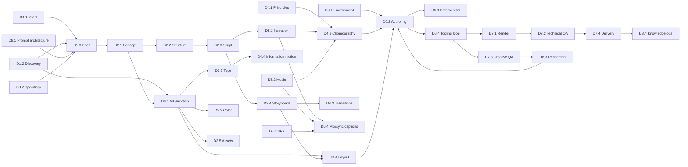

# KB-04 — Unified Skillgraph (8 domains · 44 clusters · 253 atomic skills)

*Composite. §1 is the unified competence map that HyperVideo Man carries (Hierarchical Network Notation, from `05_EXPANDED_Persona.md`). §2 is the crosswalk from every unified cluster to the clusters of both sources, so each cluster card below can be found. Part I is Source A — “HyperFrames-Motion-Mastery-Skillgraph” (v1.0, 1 Nov 2026): dependency chains, decision points, inputs and outputs by stage, feedback loops, synergy clusters, cluster cards and the gap analysis. Part II is Source B — “HyperFrames-Motion-Mastery” (Claude Code, 1 Nov 2026; CLI lab on hyperframes 0.8.229): how to read the graph, the graph at a glance, prerequisites, decision points, feedback loops and the 34 cluster cards (purpose, knowledge, techniques, application, failure modes, quality criteria). KB-05 holds the production skillmap.*

*Section numbers inside each part keep the numbering of the source they came from (A = §2–§7 and appendices of the Skillgraph document; B = Parts 3–8 of the Claude Code document). Where the two parts disagree, the preface and KB-14 govern; where either disagrees with the installed CLI, the CLI wins.*

## 1. Unified competence maps

Notation: `D# Domain` → `N.[Cluster]` → `Na.AtomicSkill` (numbers in brackets are the governing defaults); `→` dependency, `⟷` co-design, `⊕` amplification, `∩` shared resource. Every unified cluster has an owner column in the diagnosis tables (KB-09) and a card in Part I or Part II below.

```text
[D1 IntakeAndStrategy]:
1.[IntentCapture]:1a.ClassifyProjectStateAndMode 1b.TriageFormedVsUnformed 1c.FrameObjectiveAsViewerChange 1d.StateMessageLineInOutcomeLanguage 1e.InventoryConstraintsAndMandatories 1f.RunIntegrationCheck
2.[AudienceAndCulture]:2a.ModelAudienceContext(device·sound·knowledge) 2b.DetectAndServeLanguage(EN/FR) 2c.AdaptForWestAfricanAndFaithAudiences 2d.AdaptForYouthLearnersExecutives 2e.ApplyAccessibilityByDefault 2f.AvoidCulturalCliche
3.[DiscoveryAndResearch]:3a.ExtractFactsIntoClaimLedger 3b.ExtractBrandTokensFromSource 3c.MineVisualVocabularyFromSource 3d.ScanCategoryCliches(anti-pattern) 3e.AuditRightsAndLicences 3f.ProbeInstalledCapabilities(version·skills·usage·credentials)
4.[PitchAndConcept]:4a.RunSamplingGate(4 questions) 4b.GenerateFiveConcepts(5 paths) 4c.EnforceTailConstraint(2 below 0.10) 4d.CheckSilhouettes 4e.PresentAllThenRecommend 4f.RecordRejectedTypicalDirection
5.[BriefContract]:5a.FillFortyFieldSchema 5b.DeriveRunShape(flow·storyboard·mode) 5c.WriteAcceptanceAsChecksNotTastes 5d.KeepRiskAndAssumptionLogs 5e.WriteBRIEF.md 5f.SeparateStatedFromInferred
→ [D1 → D2, D3, D4, D8]  (the brief and the prompt set are inputs to everything)

[D2 StoryScriptAndNarration]:
1.[StorySpine]:1a.WriteHookInOutcomeLanguage 1b.PlaceValueClaimByBeat2 1c.OrderEvidenceAfterValue 1d.RunDeleteTests 1e.EndOnPayoffAndLockup
2.[NarrativeStructure]:2a.ChooseArcByName 2b.EngineerHookType(claim·question·contrast·number·visual change ≤0.5 s) 2c.TimeBeatsToRuntime 2d.SequenceForCognitiveLoad(one idea per beat) 2e.PlanPayoffCallbackAndCTA
3.[ScriptAndCopy]:3a.BudgetWordsToSeconds(≈2.5 w/s) 3b.WriteFrameSizedSentences 3c.WriteVOForTheEar 3d.KeepOnScreenCopyToKeywords 3e.PairWordWithPicture 3f.WriteNumbersAsSpokenAndLockSCRIPT.md
4.[NarrationProduction]:4a.CastAndDescribeVoice 4b.SetPaceForAudienceAndLanguage 4c.GenerateTTSWithWordTimestamps 4d.VerifyPronunciationByRetranscribing 4e.TrueSceneDurationsToRealVoice
5.[CaptionPlanning]:5a.ChooseGroupSizeByEnergy(2–3·3–5·4–6) 5b.SetReadingRate(≤20 cps·≥0.3 s/word) 5c.PlaceInSafeBoxOnPlate 5d.CoverEverySpokenWordAndMeaningfulSound 5e.ExportSidecarAndBurnInForFeeds
→ [D2 ⟷ D3]  (lines and beats are co-designed)  → [D2 → D7]  (word timings drive sync)

[D3 VisualSystemAndStoryboard]:
1.[ArtDirectionAndSpec]:1a.ResolveSpec(frame.md→design.md) 1b.ChoosePresetByEyeOrRemix 1c.SynthesiseReferencesWithQualityToBorrow 1d.DeclarePaletteRoles(bg·fg·accent·neutrals) 1e.NameSignatureMove 1f.ControlConsistencyAcrossScenes
2.[Typography]:2a.PickBundledOrEmbeddedFaces 2b.PairAcrossClasses(serif+sans·sans+mono) 2c.SizeForVideoAndFeed 2d.SetHoldTimes(max(1.5 s, 0.5+0.4 s/word)) 2e.TrackAndWeightForCompression 2f.UseTabularNumerals
3.[ColourLightDepth]:3a.OneAccentWithMeaning 3b.TintNeutralsAvoidPureBlackWhite 3c.PreventBanding(radial·solid·grain) 3d.OneKeyLightOneShadowRecipe 3e.MeetContrastOnWorstFrame 3f.BuildThreeDepthLayers
4.[CompositionLayout]:4a.ApplyGridAndSafeAreasPerAspect 4b.TwoFocalPointsOneAtATime 4c.AnchorToEdgesZoneLayouts 4d.ControlDensityAndNegativeSpace 4e.RecomposeForEachAspect 4f.JustifyEveryConnectorLine
5.[BeatTableAndRhythm]:5a.WriteSTORYBOARD.md 5b.TraceEveryWhyToMessage 5c.DeclareRhythmPattern 5d.Enforce3xSlowestToFastest 5e.PlanHoldsSilencesHeroMoments 5f.PlanChaptersAndPatternInterrupts
6.[PerBeatDirectionAndBoard]:6a.WriteConceptAsExperience 6b.GiveMoodReferencesNotHex 6c.NameDepthLayersAndVerbs 6d.SpecifyTransitionOutWithNumbers 6e.WriteExpandedPrompt 6f.PoseSnapshotAndConfirmStills
→ [D3 → D5, D6, D7]  (the approved plan is the build contract)  ⊕ [D1.4]  (concept amplifies direction)

[D4 AssetsAndMedia]:
1.[ResolveAndReuse]:1a.ListCandidatesBeforeResolving 1b.ResolveLogoNeverRedraw 1c.ResolveIconFamilyOneStroke 1d.ResolveImagesAndBGM 1e.AdoptUserMediaWithManifest
2.[GenerateMedia]:2a.GenerateTTS 2b.RetrieveOrGenerateBGM(mode) 2c.FireImagePlatesConcurrently 2d.GenerateAvatarOrDubWhenBriefed 2e.ChooseProviderAndConfirmCost
3.[CaptureAndImport]:3a.CaptureWebsiteTokensAndScreens 3b.ImportFigmaAssetsAndTokens 3c.StageFootageAndTranscribe 3d.RebuildUIAsHTMLAt2x 3e.FreezeRemoteAssetsLocally(no iframes)
4.[TreatmentsAndGrading]:4a.InspectContactSheetFirst 4b.ChooseOnePrimaryIntent 4c.ApplyCanonicalTreatment 4d.ShareOneGradeAcrossImages 4e.LeaveGoodMediaAlone
5.[FontsAndRights]:5a.EmbedFontFaceForEveryBrandFace 5b.QuestionMonocultureList 5c.CreditCCBYAndRecordRights 5d.RespectOfficialMusicTerms 5e.KeepStemsAndSourcesWithProject
→ [D4 → D5, D7]  ∩ [D1.3]  (brand truth shared with research)

[D5 CompositionEngineering]:
1.[EnvironmentAndProject]:1a.RunDoctorAndGateOnRequiredRows 1b.InitAndPinVersion 1c.RefreshSkillsReadInstalledSet 1d.OneSceneOneFile 1e.WriteAssetPathsWithoutLeadingSlash 1f.PlanNetworkDependencies(GSAP·fonts)
2.[TimingContract]:2a.SetRootAttributes(id·start·width·height·duration·fps) 2b.MarkClips(data-start·data-duration·class=clip) 2c.UseHalfOpenWindow 2d.UseRelativeTimingWithSpacesAndSnapshot 2e.ExtendRootWhenClipsRunPast 2f.AddNoTimelineFlagWhenTimelineFree
3.[SubCompositionsAndTracks]:3a.WrapInTemplateWithInlineStyleScript 3b.MatchHostTemplateTimelineIds 3c.PassVariablesPerInstance 3d.TrackIndexAsLaneZIndexForPaint 3e.StyleSceneRootAsRoot
4.[VariablesAndMedia]:4a.DeclareTypedVariables 4b.BindDeclaratively 4c.FlagVideoAudio(data-has-audio|muted) 4d.GiveEveryAudioAnIdAndGroup 4e.TrimWithMediaStartAndRate 4f.NeverCallPlayOrNestTimedVideo
5.[DeterminismAndPerformance]:5a.BanClocksRandomNetworkInput 5b.BoundLoopsUnderRootDuration 5c.BuildEndStateInCSSFirst 5d.SizeTransformedElements 5e.BudgetRenderCost(workers·blur·video) 5f.PinWorkersForBitIdentity
6.[ToolingLoop]:6a.LintToZeroErrorsFirst 6b.CheckWithSnapshotsAndStrict 6c.WriteMotionAssertions(*.motion.json) 6d.SnapshotMidpointsAndZoom 6e.PreviewInStudioBackground 6f.InspectAndEditTimeline(move·trim·split·set)
→ [D5 → D6]  (the contract hosts the motion)  → [D5 → D8]  (checks verify it)

[D6 MotionLanguage]:
1.[TimelineDiscipline]:1a.OnePausedTimelinePerComposition 1b.RegisterAfterBuild 1c.FromToNotFromExplicitValues 1d.AbsolutePositionsNotRelative 1e.AmbientOnTimelineNeverBareGsap 1f.HardKillInnerElementsOnly
2.[EasingAndTiming]:2a.OutInInOutDirectionRule 2b.VaryEasesAndDurations(≤2 shared per scene) 2c.AsymmetricExits(60–70 %) 2d.OffsetFirstMotion(0.1–0.3 s) 2e.SpeedIsWeight(bands) 2f.BudgetMotion(no idle loops on content)
3.[ChoreographyAndRhythm]:3a.StaggerByImportance(<500 ms) 3b.OverlapEntries 3c.BuildBreatheResolve 3d.AlignToVoiceAndBeatGrid 3e.KeepObjectConstancy 3f.LandAndHoldForReading
4.[CameraAndImageMotion]:4a.PushInsAndPunchIns 4b.ParallaxPlanes(2–4·small amplitude) 4c.KenBurnsOnChild 4d.PerspectiveViaGSAPNotCSS 4e.AnimateWrapperNotClip 4f.SplitConflictingTransforms
5.[Transitions]:5a.ChooseCutCSSOrShaderByRelation 5b.OnePrimaryPlusTwoAccents 5c.VelocityMatchSeams(~5 %) 5d.LimitShaderHeroes(1–2 per 5–7 beats) 5e.LetTransitionOwnSceneExit 5f.UseHardCutsForMeaning
6.[InformationMotionAndRegistry]:6a.NamedTextEffects(24 ids) 6b.HonestDataMotion(zero baselines·staged·no overshoot) 6c.CaptionAndCalloutMotion 6d.SearchCatalogBeforeBuilding 6e.InstallBlocksOnceRestyleToBrand 6f.ChooseRuntimeAdapterAndDepth(CSS→GSAP→WebGL)
→ [D6 ⟷ D7]  (motion and sound locked frame to frame)  ⊕ [D3.6]  (direction amplifies craft)

[D7 AudioDesign]:
1.[StrategyAndVoiceBus]:1a.ChooseSoundStrategyFirst 1b.GroupNarrationInHfAudioGroup 1c.CleanChain(HPF·compressor·clarity) 1d.HoldVoiceWithin2LU 1e.KeepVoiceLeadMonoCompatible
2.[Music]:2a.ApplyDecisionRule 2b.WritePasteReadyBrief(theme·audience) 2c.RetrieveOrGenerate(mode·licence) 2d.EditOnBarLinesEndOnButton 2e.CarveAgainstVoiceGroup(0.8·lower if notched) 2f.MapEntryBuildReductionSilenceResolution
3.[SFXAndSilence]:3a.NameSoundsConcretely 3b.BudgetByStyleAndRuntime 3c.PlaceOnContactFrame(0 to +1·never early) 3d.OneSoundPerStaggerVaryVariants 3e.ReserveHeroHits(≥15 s apart) 3f.DesignSilenceBeforeKeyLine
4.[Sync]:4a.CutOnBeatGrid 4b.PeakWhooshOnCut 4c.StartRiserAtRevealMinusLength 4d.JCutTailsAndAmbience 4e.SuckOutBeforeBigHit 4f.LockLightToSound
5.[MixLoudnessAndCaptions]:5a.SetLevelStackVsVO 5b.AutomateWithLanesNotTweens 5c.TruepeakLimiterLastAtMinus3 5d.MeasureDeliveredFile(ebur128·qa_render) 5e.PhoneAndMonoCheck 5f.SeparateStemsAndSidecarCaptions
→ [D7 → D8]  (measured before delivery)  ∩ [D2.4]  (word timings)

[D8 PromptQualityAndCoaching]:
1.[PromptArchitecture]:1a.WriteMetaPrompt(how to work) 1b.WriteSystemPrompt(the standard) 1c.WriteMasterPrompt(this film) 1d.WriteStagePrompts(plan·sketch·build·verify·refine·deliver) 1e.WriteEvaluatorPrompt(separate judge) 1f.AssembleSurgicalPromptSet
2.[SpecificityEngineering]:2a.AskAtMostThreeQuestions 2b.LogDefaultsWithReasons 2c.TranslateAdjectivesToSpecs 2d.ImposeAntiGenericBans 2e.AnchorReferencesWithQualityToBorrow 2f.RestateHardSpecsEveryTurn
3.[VerifyAndMeasure]:3a.GateLintCheckSnapshots 3b.ReadFrameStripsAcrossCuts 3c.RunMutedBlindScrubPasses 3d.MeasureFfprobeEbur128 3e.ScoreThirtyFiveItemsAndTwelveDimensions 3f.UseSeparateJudgeWithEvidence
4.[RenderAndDeliver]:4a.DraftThenDeliveryQuality 4b.ChooseContainerAndAlpha 4c.RenderVariantsFromVariables 4d.RenderSpansOrChunks 4e.CloudOrLambdaWithPrivacy 4f.PackagePublishHandoffRecipe
5.[RepairProtocol]:5a.WatchThreeWaysFreezeThreeFrames 5b.LocateSymptomCauseOwningSkill 5c.ReviseByTimeSymptomResultScope 5d.OneVariableFreezeList 5e.RerenderAffectedSpanCompareStills 5f.StopRuleKeepBest
6.[CoachAndKnowledge]:6a.ExplainPrincipleNumberExample 6b.SetExerciseAndWatchFor 6c.WriteHANDOFFAndLessons 6d.ExtractBlocksAndTemplates 6e.WatchVersionAndSkillDrift 6f.FreezeRecipesAndPreferences
→ [D8 → D1]  (lessons, recipes and preferences feed the next intake)  → [D8 → D3, D5, D6, D7]  (findings re-enter at the artefact they touch)
```

## 2. Crosswalk — unified cluster → source clusters

| Unified cluster | Name | Source A cluster(s) (8 domains · 40 clusters · 220 skills) | Source B cluster(s) (8 domains · 34 clusters) |
|---|---|---|---|
| D1.1 | IntentCapture | A D1.1 BriefIntake | B D1.1 Intent capture and clarification |
| D1.2 | AudienceAndCulture | A D1.1 BriefIntake (audience fields) · A D7.2 Music (audience adjustments) | B D1.1 · B D1.3 Brief contract |
| D1.3 | DiscoveryAndResearch | A D1.3 ResearchAndSourceMining | B D1.2 Discovery and research |
| D1.4 | PitchAndConcept | A D1.2 PitchAndConcept | B D2.1 Concept development |
| D1.5 | BriefContract | A D1.1 BriefIntake (brief contract) | B D1.3 Brief contract |
| D2.1 | StorySpine | A D2.1 StorySpine | B D2.2 Narrative structure |
| D2.2 | NarrativeStructure | A D2.1 StorySpine · A D3.2 RhythmAndPacing | B D2.2 Narrative structure |
| D2.3 | ScriptAndCopy | A D2.2 ScriptWriting | B D2.3 Script and copy |
| D2.4 | NarrationProduction | A D2.3 NarrationProduction | B D5.1 Narration |
| D2.5 | CaptionPlanning | A D2.4 CaptionPlanning | B D4.4 Information motion (captions) · B D5.4 Mix, sync and captions |
| D3.1 | ArtDirectionAndSpec | A D1.4 DesignSpecAndVisualSystem | B D3.1 Art direction and style |
| D3.2 | Typography | A D1.4 DesignSpecAndVisualSystem | B D3.2 Typography |
| D3.3 | ColourLightDepth | A D1.4 DesignSpecAndVisualSystem | B D3.3 Color and light |
| D3.4 | CompositionLayout | A D1.4 · A D5.5 DeterminismAndLayout | B D3.4 Composition and layout |
| D3.5 | BeatTableAndRhythm | A D3.1 BeatTable · A D3.2 RhythmAndPacing | B D2.4 Storyboard and animatic · B D4.2 Choreography and rhythm |
| D3.6 | PerBeatDirectionAndBoard | A D3.3 PerBeatDirection · A D3.5 BoardAndApproval | B D2.4 Storyboard and animatic |
| D4.1 | ResolveAndReuse | A D4.1 ResolveAndReuse | B D3.5 Asset craft · B D6.5 Integrations |
| D4.2 | GenerateMedia | A D4.2 GenerateMedia | B D6.5 Integrations · B D5.1 · B D5.2 |
| D4.3 | CaptureAndImport | A D4.3 CaptureAndImport | B D6.5 Integrations |
| D4.4 | TreatmentsAndGrading | A D4.4 TreatmentsAndGrading | B D3.5 Asset craft |
| D4.5 | FontsAndRights | A D4.5 FontsAndRights | B D3.2 Typography · B D7.4 Delivery and handoff (rights) |
| D5.1 | EnvironmentAndProject | A D5.1 ProjectStructure | B D6.1 Environment and project |
| D5.2 | TimingContract | A D5.2 TimingContract | B D6.2 Composition authoring |
| D5.3 | SubCompositionsAndTracks | A D5.3 SubCompositionsAndTracks | B D6.2 Composition authoring |
| D5.4 | VariablesAndMedia | A D5.4 VariablesAndMedia | B D6.2 Composition authoring |
| D5.5 | DeterminismAndPerformance | A D5.5 DeterminismAndLayout | B D6.3 Determinism and performance |
| D5.6 | ToolingLoop | A D8.1 StaticAndRuntimeChecks | B D6.4 Tooling loop |
| D6.1 | TimelineDiscipline | A D6.1 TimelineDiscipline | B D6.2 Composition authoring · B D4.1 Motion principles |
| D6.2 | EasingAndTiming | A D6.2 EasingAndTiming | B D4.1 Motion principles |
| D6.3 | ChoreographyAndRhythm | A D6.3 ChoreographyAndText | B D4.2 Choreography and rhythm |
| D6.4 | CameraAndImageMotion | A D6.4 CameraAndImageMotion | B D4.5 Advanced techniques |
| D6.5 | Transitions | A D6.5 Transitions | B D4.3 Transitions |
| D6.6 | InformationMotionAndRegistry | A D6.3 ChoreographyAndText (text effects) · A D6.6 BlueprintsAndRegistry | B D4.4 Information motion · B D4.5 Advanced techniques |
| D7.1 | StrategyAndVoiceBus | A D7.1 VoiceBus | B D5.1 Narration · B D5.4 Mix, sync and captions |
| D7.2 | Music | A D7.2 Music · A D3.4 MusicMapAndCueSheet | B D5.2 Music |
| D7.3 | SFXAndSilence | A D7.3 SFX · A D3.4 MusicMapAndCueSheet | B D5.3 Sound effects and silence |
| D7.4 | Sync | A D7.4 Sync | B D5.4 Mix, sync and captions |
| D7.5 | MixLoudnessAndCaptions | A D7.5 MixAndLoudness | B D5.4 Mix, sync and captions |
| D8.1 | PromptArchitecture | A §4 prompting system · A D1.1 BriefIntake | B D8.1 Prompt architecture |
| D8.2 | SpecificityEngineering | A §4.5 ambiguity and anti-generic rules | B D8.2 Specificity engineering |
| D8.3 | VerifyAndMeasure | A D8.1 StaticAndRuntimeChecks · A D8.2 VisualReviewPasses · A D8.4 MeasureAndScorecard | B D7.2 Technical QA · B D7.3 Creative QA · B D8.3 Evaluation and refinement |
| D8.4 | RenderAndDeliver | A D8.3 RenderAndFormats · A D8.5 PublishAndPackage | B D7.1 Render and encode · B D7.4 Delivery and handoff |
| D8.5 | RepairProtocol | A D8.6 RevisionAndKnowledge | B D8.3 Evaluation and refinement |
| D8.6 | CoachAndKnowledge | A D8.6 RevisionAndKnowledge | B D8.4 Knowledge operations |

Coverage: all 40 clusters of source A and all 34 clusters of source B map to at least one unified cluster; six unified clusters are new splits (D1.2 AudienceAndCulture, D1.5 BriefContract, D5.6 ToolingLoop, D6.6 InformationMotionAndRegistry, D8.1 PromptArchitecture, D8.5 RepairProtocol) created so that culture, the brief contract, the tooling loop, information motion, prompt architecture and repair each own their failure modes.

## Part I — Source A — “HyperFrames-Motion-Mastery-Skillgraph” (v1.0, 1 Nov 2026)

#### 5.2 Relationships — prerequisites, dependencies, decision points, inputs/outputs, feedback loops

##### 5.2.1 Dependency chains (hard prerequisites)

| This skill | Requires | Because |
|---|---|---|
| D3.1 BeatTable | D1.1c message line; D1.4 design spec | No storyboarding until the message is clear [Documented]; the spec is quoted by the expansion |
| D3.3 PerBeatDirection (expansion) | D3.1 approved plan; D1.4 spec | Expansion without a design context produces generic breakdowns later agents ignore [Documented] |
| D2.3e TrueSceneDurations | D2.3c word timings; D5 frames | Real voice length wins; synced values never hand-edited [Documented] |
| D7.4 Sync | D2.3c word timings; D3.4e cue sheet; D7.2c music grid | Sync points are defined by words, cues and beats |
| D7.2e Carve | D7.1a voice group; D7.2c bed placed | A carve needs grouped sources (lint `audio_carve_ungrouped_sources`) |
| D6.5c InstallShaderBlock | D6.6b blocks installed before parallel work | Parallel workers race the registry [Documented] |
| D5.3b MatchIds | D5.1c mounted sub-comps | Mismatched timeline keys render frozen at t=0 when two or more timelines exist [Documented] |
| D8.2a SnapshotMidpoints | D8.1a lint 0 errors | A lint error disables layout and contrast audits; snapshots are then the only visual evidence |
| D8.3b DeliveryRender | D8.3a approved preview | Rendering is user-gated in both modes [Documented] |
| D8.4b Loudness measurement | D8.3b render | Measure the encoded mix, not the stems |
| D4.3d RebuildUIAsHTML | D1.3a facts; D4.3a capture | Rebuilt UI must show the real screens' content, not invented controls |
| D1.2 Pitch round | D1.1b triage = unformed | Formed requests skip it; recipe adoption skips it [Documented] |

##### 5.2.2 Decision points

| Decision | Options | Rule | Owner |
|---|---|---|---|
| Route | 10 workflows | Match the deliverable, not a word in passing; narrative genres ≤ 3 min; longer → `/general-video` | D1.1 |
| Run shape | flow automation/companion × storyboard yes/no → mode | Autonomous signal → automation + no storyboard; render stays user-gated | D1.1e |
| Formed vs unformed | questions vs pitch round | Unformed → five concepts, two below the median | D1.1b → D1.2 |
| Design spec | have one / pick by eye / don't care / nothing fits → picker | Never pick from names; a remix keeps the layout bones, not the colours | D1.4 |
| Music | none / required / near-silent / no-melody bed / scored | §3.6.3 order; then the mute test | D3.4a, D7.2a |
| Transition type per handoff | cut / CSS / shader | Centrepiece → shader; connective → CSS; percussive → cut; 1–2 shaders per 5–7 beats | D3.3e, D6.5a |
| Font | bundled / embed `@font-face` / Google fetch | Predictable renders use bundled or embedded; cloud renders fail closed on fetch | D4.5a |
| UI representation | rebuild as HTML / screenshot / capture panel | Marketing → rebuild; training → real screenshots; never iframes | D4.3d |
| Scene file structure | monolithic / one scene per file | Past ~40–60 s, one scene per file | D5.1b |
| Root duration | explicit / inferred | Three.js, infinite CSS/WAAPI, no-timeline → explicit; otherwise inferred allowed but explicit preferred | D5.2a |
| Render path | local / cloud / Lambda / Docker | Local free and default; cloud for fps/quality on paid plans; Docker for cross-machine parity | D8.3 |
| Quality tier | draft while iterating / delivery for final | Flag names differ across docs (`--quality draft|standard|high` vs CRF tiers) — check `render --help` | D8.3b |
| Captions | burned-in / sidecar / both | Sound-off surfaces → burned-in plus SRT; accessibility-critical → always | D2.4 |

##### 5.2.3 Inputs and outputs by stage

| Stage | Inputs | Outputs | Gate |
|---|---|---|---|
| Briefing | request, memory/preferences, recipes, probed capabilities | `BRIEF.md` (frontmatter + Intent/Assets/Customizations/Notes) | hand-off summary confirmed |
| Research | source material, brand assets, prior films | fact list, visual vocabulary, anti-pattern note, gap register | facts verified or labelled |
| Concept & spec | brief, presets, palettes, typography | `frame.md`, concept statement, signature move | spec quoted verbatim downstream |
| Scripting | message, arc, runtime | `SCRIPT.md` (locked), word budget | read-aloud pass |
| Storyboarding | spec, script, beat table | `STORYBOARD.md`, music map, cue sheet, `.hyperframes/expanded-prompt.md`, `boards/storyboard.html` | plan approved; board confirmed |
| Assets | brief Assets, resolve/generate, capture | `assets/`, `.media/manifest.jsonl`, `audio_meta.json`, fonts | candidates judged; rights recorded |
| Implementation | spec, expanded prompt, confirmed stills | `index.html`, `compositions/frames/NN-*.html`, variables | lint 0 errors |
| Animation | blueprints, rules, transitions | timelines per scene, injected handoffs | check 0 findings |
| Audio | word timings, bed, SFX | placed `<audio>` clips, groups, carve, automation, limiter | levels verified; carve present |
| Verify | index + captions + transitions | snapshots, contact sheet, animation map, scorecard draft | all passes done |
| Render & export | approval | MP4/MOV/WebM/GIF/PNG/HLS, variants, SRT/VTT, stems | ffprobe + ebur128 pass |
| QA & iteration | render, scorecard | revision list by timestamp, `HANDOFF.md`, recipe | weakest scene fixed; evidence reported |

##### 5.2.4 Feedback loops

1. **Duration sync loop** — real voice durations re-time the storyboard and frames; silent scenes keep estimates. (D2.3 → D3.1 → D5)
2. **Lint/check loop** — findings re-enter at the artefact they touch and re-run Verify; never render with a lint error, which also blinds the audits. (D8.1 → D5/D6 → D8.1)
3. **Sketch loop** — board feedback re-poses only the frames named and replaces only their stills. (D3.5 ⟷ D1.4/D3.3)
4. **Review loop** — muted, blind and scrub passes name the weakest scene; revision by timestamp; re-render only the affected span (`render --start/--end`). (D8.2 → D8.6 → D8.3)
5. **Memory loop** — confirmed brief values record preferences (destination, aspect, language, flow, storyboard, voice, style_preset per workflow); an approved run freezes a recipe; `HANDOFF.md` carries fixes into the next build. (D8.5/D8.6 → D1.1)
6. **Capability loop** — version probe and `skills check` before each run; a changed skill set or flag vocabulary updates the system prompt. (D1.3e → system prompt)

##### 5.2.5 Synergy clusters (where skills amplify each other)

- **Rhythm × Music × Transitions** (D3.2 ⊕ D7.2 ⊕ D6.5): a declared rhythm aligned to a bar grid makes transition choices self-evident and SFX placement mechanical.
- **Spec × Expansion × Frames** (D1.4 ⊕ D3.3 ⊕ D5/D6): quoting tokens in the expansion means every parallel frame worker produces the same film.
- **Word timings × Captions × On-word motion × Carve** (D2.3 ⊕ D2.4 ⊕ D6.3 ⊕ D7.2e): one timing source drives four outputs.
- **Source mining × Visual vocabulary × Anti-generic** (D1.3 ⊕ D3.3 ⊕ D1.2): props from the source are the cheapest way out of the median.
- **Snapshot × Scorecard × HANDOFF** (D8.2 ⊕ D8.4 ⊕ D8.6): evidence collected once serves approval, acceptance and the next project.

#### 5.3 Cluster cards — purpose, knowledge, techniques, failure modes, quality criteria

##### D1 IntentAndDirection

| Cluster | Purpose | Required knowledge | Techniques | Common failure modes | Quality criteria |
|---|---|---|---|---|---|
| 1 BriefIntake | Turn a request into a confirmed `BRIEF.md` without re-asking | Project-state table; route table; run-shape derivation; shared fields and their policies | First-matching-row routing; one field per question; recommended option first; integration check; stated-vs-inferred summary | Asking what the request answered; routing on a word in passing; treating inference as an answer; storyboarding before the message exists | Brief frontmatter complete and normalised; message in outcome language; derived values carry receipts |
| 2 PitchAndConcept | Replace the blank "what's the message?" with five concepts the user can want | Sampling gate questions; five concept paths; tail constraint; silhouette check; capability-menu phrasing | Estimate median-probability per concept; show all five before recommending; mixing is a first-class answer; autonomous runs walk the gate silently | Five median concepts; recommendation stated first; machinery listed as features; skipping the gate in autonomous mode | ≥ 2 concepts below 0.10; distinct silhouettes; chosen concept lands in `BRIEF.md § Intent` and its capabilities in `§ Customizations` |
| 3 ResearchAndSourceMining | Ground every visual and claim in the source and the installed tool | Source types; story-spine §4; version/skill/usage probes; evidence tags | Extract entities, verbs, motifs; verify numbers; register placeholders; `--version`, `skills check`, `usage --json`, `upgrade --check` | Invented stats or UI; generic props; assuming a flag or skill name; guessing usage | Every key visual traceable to a source line; every placeholder labelled; version and skill set reported |
| 4 DesignSpecAndVisualSystem | Lock brand truth before any HTML | Spec resolution order; frontmatter normative / prose context; presets and showcases; palette families; typography selection thinking; light/shadow recipe | Pick by eye from 2–3 showcases; declare bg/fg/accent/neutrals; register-first font choice; one shadow recipe; one signature move | Picking presets from names; two similar sans; banned-font monoculture; web-UI opacity on video; no accent | `frame.md` exists and is quoted verbatim downstream; one accent; cross-class type pair; key light named |

##### D2 StoryAndScript

| Cluster | Purpose | Required knowledge | Techniques | Common failure modes | Quality criteria |
|---|---|---|---|---|---|
| 1 StorySpine | Order the film value-first | Reverse iceberg; hook language; arc catalogue; delete tests | Hook answers "why should I care"; value by beat 2; evidence after; run both delete tests on the beat list | Feature tour; inventory numbers in the hook; logo-first; advertising arc forced on instruction | Delete-evidence test passes; delete-value test fails (as it should); hook type varied |
| 2 ScriptWriting | Produce narration that fits the runtime and sounds human | 2.5 w/s natural; genre bands; number pronunciation; opening-line patterns | Budget words first; frame-sized sentences; contractions; read aloud; write numbers as spoken; lock `SCRIPT.md` | Overlong script; brochure voice; TTS mis-reading "135+" or "ID"; rewriting after build | Word count within ±10 % of the band; no generic opening; locked before TTS |
| 3 NarrationProduction | Turn the script into timed voice | Audio engine request/meta; word timestamps; Parakeet/whisper; duration sync rule | Describe the voice precisely; run TTS in the background; retranscribe to verify; true durations to real voice | Estimated timings treated as final; acronyms mispronounced; hand-edited synced values | `audio_meta.json` with `words[]`; scene durations trued; voice within ±2 LU |
| 4 CaptionPlanning | Carry the story with the sound off | Group sizes; cps; chars per line; safe zones; contrast plate; SRT/VTT | Choose group size by energy; one group at a time; plate over busy backgrounds; export sidecar | Captions as full transcript on screen with the headline; > 20 cps; captions under platform UI | ≤ 20 cps, ≤ 42 chars/line, 2 lines; every spoken word; inside title-safe |

##### D3 StoryboardAndRhythm

| Cluster | Purpose | Required knowledge | Techniques | Common failure modes | Quality criteria |
|---|---|---|---|---|---|
| 1 BeatTable | Make the plan reviewable and parseable | `STORYBOARD.md` format; statuses; frame metadata keys; beat counts per runtime | One `## Frame N` per beat; `- why:` traced; `- duration:`; `- voiceover:`; status progression | Frames without a why; beat count beyond the runtime band; frontmatter copies disagreeing with `BRIEF.md` | Parser warnings = 0; every why traces; `message`/`audience` match the brief |
| 2 RhythmAndPacing | Give the film a felt structure | Rhythm declaration; 3× rule; build/breathe/resolve; hero spacing; long-form chapters | Name the pattern; mark holds and silences; place hero moments with timestamps | Uniform pace; everything a hero; no holds; dead zones | Pattern named before HTML; ≥ 1 hold ≥ 1 s; hero hits ≥ 15 s apart |
| 3 PerBeatDirection | Make each beat a world the builders can realise | Concept-as-experience; mood references; depth layers; verb vocabulary; 24 text effects; transition table; expansion output format | Write the experience first; a verb per element; "blur crossfade 0.4 s power2.inOut" not "crossfade"; write to `.hyperframes/expanded-prompt.md` | Pixel descriptions instead of experiences; "it animates in"; pass-through expansion | Every element has a verb; every transition has type, duration, ease; spec values quoted |
| 4 MusicMapAndCueSheet | Design sound into the plan | Decision rule; music map; SFX density matrix; level stack; cue sheet fields | Decide music by rule; map entry/build/reduction/silence/resolution; budget cues; write the sheet | Music added after the build; whoosh per cut; hero hits every 5 s; no designed silence | Decision stated with reason; cue count within band; ≥ 1 silence per 60 s in story pieces |
| 5 BoardAndApproval | Earn fidelity one pass at a time | Storyboard recipe; board classes; snapshot usage; checkpoint gates | Pose real words/fonts/colours; snapshot all stills in one run; re-pose only named frames; stop at a confirmed board when it is the deliverable | Unstyled wireframes; redrawing confirmed layouts; snapshotting single stills into the board folder | Every frame `built` with a still; board accepted; layouts untouched in the build |

##### D4 AssetsAndMedia

| Cluster | Purpose | Required knowledge | Techniques | Common failure modes | Quality criteria |
|---|---|---|---|---|---|
| 1 ResolveAndReuse | Get real assets deterministically | `resolve --type`; candidates; adopt; manifest | List candidates first; resolve logo/icon/image/bgm/sfx by intent; adopt user media | Redrawn logos; emoji as icons; placeholders left as fakes | One line per resolved asset; manifest records; icon family consistent |
| 2 GenerateMedia | Fill catalogue gaps | Provider orders; OAuth/credits; background execution; wait-bgm | Fire known generations concurrently; wait before render; state the provider used | Serial generation; rendering while BGM is pending; silently dropping a capability when a credential is missing | All pending generations complete; blockers surfaced, not hidden |
| 3 CaptureAndImport | Bring the real world in | `capture`; Figma REST/CLI; transcribe; footage staging; UI rebuild | Capture screens and tokens; rebuild UI as HTML at 2×; stage footage; never iframes | Iframes; blurry screenshots; invented UI controls | Screens traceable to the real product; crisp at 4K; tokens from the real site |
| 4 TreatmentsAndGrading | Make media belong | Media-treatments doc; canonical persistence; contact-sheet inspection | One primary intent; one before/after sheet; shared grade; leave good media alone | CSS filters bypassing Studio; gray-world correction of an intentional look; a different grade per image | Treatment persisted canonically; one grade across images; no unmotivated effects |
| 5 FontsAndRights | Render predictably and legally | Bundled list and weights; `@font-face`; cloud fail-closed; CC0/CC BY credit; Church terms for official music | Bundled or embedded; credit where published; record rights in the brief | Google-fetched fonts in cloud renders; commercial tracks (Content ID); uncredited CC BY | No font warnings; rights recorded; credits included |

##### D5 CompositionEngineering

| Cluster | Purpose | Required knowledge | Techniques | Common failure modes | Quality criteria |
|---|---|---|---|---|---|
| 1 ProjectStructure | A project agents can edit safely | Init templates; monolithic vs modular; Studio layout conventions; `timeline --json` | One scene per file past a minute; prefix ids by composition; one caption track; one element kind per track | 60 s in one file; duplicate ids; unreadable Studio timeline | `timeline` lists every clip as intended; ids unique |
| 2 TimingContract | Make the DOM declare time correctly | Root attributes; `data-start` marks a clip; half-open window; relative timing failure modes; derived duration lint | Explicit root `data-duration`; land end states before `data-duration`; spaces in `"intro + 0.5"`; snapshot reference-timed clips | Last frame never rendered; clip silently at 0; clip past root cut off; Three.js without explicit duration | lint clean; reference timing verified by snapshot; root duration = runtime |
| 3 SubCompositionsAndTracks | Compose scenes without silent breakage | `<template>` transport rule; id convention; per-instance variables; tracks as lanes; z-index and isolation | `<style>`/`<script>` inside the template; same id for host, template and timeline key; CSS for layering | Styles dropped from the head; mismatched ids freezing at t=0; believing track 5 is "above" track 1 | Sub-comps render identically in preview and render; no frozen frames |
| 4 VariablesAndMedia | Parameterise and place media correctly | Variable schema vs values; bindings; media rules; `data-has-audio`/`muted`; trims; linked clips | Declarative bindings; fallback `src` for audio; `--variables-file` for variants; separate `<audio>` for music/VO | `play()` calls; `crossorigin`; video inside a timed wrapper; id-less `<audio>` (silent render) | Variants render from one source; every media rule lint-clean; audio present in the export |
| 5 DeterminismAndLayout | Same time → same pixels | Determinism bans; loop bounding; layout contract; pretext/fitText; block-level transforms | Seeded PRNG; `floor` repeat counts; end state in CSS first; `max-width` wrapping; sized transformed elements | Random layouts; infinite loops without root duration; `<br>` overlaps; invisible scaled spans | Renders reproducible across runs and worker counts (pinned); no overflow findings |

##### D6 AnimationCraft

| Cluster | Purpose | Required knowledge | Techniques | Common failure modes | Quality criteria |
|---|---|---|---|---|---|
| 1 TimelineDiscipline | Seekable, deterministic motion | One paused timeline; register after build; `fromTo`; absolute times; ambient on `tl`; slot padding | Build in `fonts.ready`, register last; `immediateRender:false` where needed; proxy values for linked numbers | `from()` flashes; wall-clock ambient absent in render; relative tweens drifting; black flashes between beats | Scrubbing backward and in random order matches playback; no still-frame renders |
| 2 EasingAndTiming | Motion that means something | Direction rule; speed bands; asymmetry; first-motion offset; ease vocabulary | `.out` enter / `.in` exit / `.inOut` move; vary eases; exits 60–70 %; 0.1–0.3 s offset | Same ease everywhere; ease-in entrances; uniform 0.4 s durations | ≤ 2 shared eases per scene; 3× slowest/fastest; exits faster |
| 3 ChoreographyAndText | Hierarchy through sequence | Stagger by importance; overlap; text effects; build/breathe/resolve; inner hard-kill | Move the most important thing first; < 500 ms stagger total; named text effect ids; kill inner elements, never the clip | DOM-order staggers; everything at once; resurrected elements; tweening `.clip` visibility | First mover = most important; no element flash; scene has one ambient motion |
| 4 CameraAndImageMotion | Depth and life | Push/punch/parallax; Ken Burns; perspective via GSAP; wrapper vs clip; conflicting transforms | Animate the inner wrapper; split entrance (parent) and Ken Burns (child); `transformPerspective` not CSS perspective | Raw flat images; GSAP overwriting CSS perspective; invisible images from overlapping transforms | Every image treated; no transform conflicts; parallax planes consistent |
| 5 Transitions | Handoffs with meaning | Cut/CSS/shader table; velocity matching; shader catalogue and durations; hero-transition budget | Shader into the centrepiece; crossfade connective tissue; hard cuts on the beat; match exit/entry velocity | Crossfade everything; a different preset per scene; 0.8 s transitions in a rapid run | 1–2 shaders per 5–7 beats; velocity matched within ~5 %; no accidental jump cuts |
| 6 BlueprintsAndRegistry | Don't hand-build what exists | `catalog --query`; `add`; blueprint ids; wiring blocks; custom GLSL when nothing fits | Search first; install once before parallel work; restyle to brand; cite blueprint ids in the plan | Hand-built charts/captions; registry races; over-engineering simple motion with Three.js | Blocks installed and restyled; plan cites blueprints; no invented names |

##### D7 AudioDesign

| Cluster | Purpose | Required knowledge | Techniques | Common failure modes | Quality criteria |
|---|---|---|---|---|---|
| 1 VoiceBus | A voice that always wins | `<hf-audio-group>`; `data-fx-chain`; compressor/clarity; ±2 LU | Group narration; HPF, compressor ~−18 dB 3:1, +2 dB at 3 kHz; keep lead | Ungrouped clips; over-processing every voice; VO buried by bed | Intelligible on phone and mono; loudness within ±2 LU |
| 2 Music | Emotion scored to the arc | Decision rule; brief writing; `bgm.mode`; bar-line editing; carve; endings | Decide by rule; one bed; cut on bars; carve against the voice group; end on a button | Music by default; drops under VO; fade mid-phrase; duck-only "mix" | Decision reasoned; carve present; ending clean; mute test passed |
| 3 SFX | Punctuation, not noise | Palette table; density matrix; variants; hero spacing; Openverse/CC credits | Name sounds concretely; budget by style; one sound per stagger; 2–4 variants; hero hits rare | Whoosh per cut; same sample thrice; SFX louder than voice; "Mickey-Mousing" | Count within band; no sample ×3; ≥ 8 dB under voice during speech |
| 4 Sync | Picture and sound as one event | ±1 frame; BT.1359 thresholds; riser/impact/whoosh rules; beat grid; light-sound coupling | Land transients 0 to +1 frame; riser = reveal − length; suck-out 0.3–1 s before the hit; cuts on beats | Early SFX; whoosh starting at the cut (lands late); hero without light hit | Every transient within ±1 frame, none early; light within ±1 frame of sound |
| 5 MixAndLoudness | Deliver to spec | Level stack; automation lanes; limiter ceiling; LUFS/dBTP; stems | Levels vs VO; `data-automation` lanes; truepeak limiter last at −3 dBTP; measure with ebur128; stems | Mixing to the preview volume; guessing loudness; one stem; a 100 ms click judged by integrated LUFS | Integrated loudness on target ±1 LU; true peak ≤ −1 dBTP; stems delivered |

##### D8 VerifyDeliverIterate

| Cluster | Purpose | Required knowledge | Techniques | Common failure modes | Quality criteria |
|---|---|---|---|---|---|
| 1 StaticAndRuntimeChecks | Catch the catchable | lint rules; check audits; render summary second line; silent-zero timing; font embedding | lint to 0 errors first; check to 0 findings; read `beginframe` vs `screenshot` and GPU mode; verify references by snapshot | Trusting "0/0 text checks" after a lint error; ignoring the software-GPU slow path | 0 lint errors, 0 check findings, audits actually ran |
| 2 VisualReviewPasses | Catch what lint cannot | Contact sheets; freeze-frame test; muted/blind/scrub passes; animation map | One contact sheet beats N single views; schedule visual checks at phase boundaries | Judging motion from a still; never watching muted; never scrubbing seams | Weakest scene named with a fix; no dead zone > 2 s; seams clean |
| 3 RenderAndFormats | Produce the right file | Containers/codecs; alpha paths; 4K supersampling cost; `--workers`; `--start/--end`; batch variables; cloud/Lambda limits | Draft while iterating, delivery for final; `--workers 1` for video-heavy; variants from variables; chunk long renders | Rendering before approval; 4K by default; HDR expectations on Lambda; file size unchecked | Approved first; correct container; variants consistent; sane size |
| 4 MeasureAndScorecard | Prove it | ffprobe; ebur128; frozen/black-frame scan; the 35 items | Measure, don't guess; report PASS/FAIL/NOT VERIFIABLE with evidence | Self-declared compliance; metadata read as output | Every item evidenced; unverifiable items listed |
| 5 PublishAndPackage | Hand over completely | `publish` visibility; captions/stems/cut-downs; assumptions list; recipe freeze; Studio/desktop app lines | Private by default; explicit visibility; offer the recipe once; point to the app once | Public by accident; missing stems; re-nagging about recipes | Package complete; visibility explicit; recipe offered once |
| 6 RevisionAndKnowledge | Improve the right thing | Weakest-first; revision syntax; span re-render; doctor/lint/check diagnosis; HANDOFF; version tracking | Time · symptom · result · scope; re-render the affected span; log fixes; probe version each run | Polishing the strongest scene; re-rendering everything; forgetting fixes; stale skill names | Revision addressed by timestamp; HANDOFF updated; version and skill set recorded |

#### 5.4 Gap analysis against the source domain

Coverage check against the thirteen stages the brief named (briefing, research, concept, scripting, storyboarding, asset preparation, implementation, animation, audio, rendering, export, QA, iteration): all thirteen map to at least one cluster (export sits inside D8.3 and D8.5). Known thin areas, by design: interactive decks (`/slideshow`) and Remotion porting are routed, not decomposed, because their deliverable is not a motion video; talking-head packaging and captions-only routes are covered at the level of routing and caption craft, not footage editing. These are documented capability boundaries (§7.9), not omissions of the skillgraph.

## Part II — Source B — “HyperFrames-Motion-Mastery” (Claude Code, 1 Nov 2026; CLI lab on hyperframes 0.8.229)

#### 5.1 How to read the skillgraph

**Notation.** The graph follows the Hierarchical Network Notation of `/qualia-nexus-forge` [DOC] [S-04]: Domain Category → Skill Cluster → Atomic Skill. IDs are hierarchical: `D4.2c` is domain 4, cluster 2, atomic skill c. Relationship operators: `→` requires (prerequisite), `⟷` peer exchange, `⊕` amplifies, `∩` shares an artifact.

**Granularity rule.** An atomic skill passes the Architect test "can the agent DO this specific thing?" [DOC] [S-04] and a second test added here: "can a reviewer check that it was done?" If a skill cannot be checked, it is decomposed further; if two skills are always checked together, they are merged.

**Cluster cards.** Every cluster has six fields, as the brief for this document requires:

- **Purpose**: why the cluster exists and what breaks without it.
- **Required knowledge**: what the agent must know before acting.
- **Techniques**: the methods that produce quality.
- **Practical application**: how it is done in a HyperFrames project, naming files, commands and artifacts.
- **Failure modes**: the common ways it goes wrong, so they can be recognised early.
- **Quality criteria**: the pass conditions a reviewer checks.

Each card ends with an atomic-skill table: what to do, the typical failure, and the check that proves it was done.

**Evidence.** Claims about HyperFrames behaviour cite Part 2 and the source registry (Part 8). Craft numbers (durations, loudness, caption rates) are not repeated here; they live in Part 3 (`quality-framework.md`, `audio-direction.md`) so they are maintained in one place. Most card content is synthesis, so it carries an implicit [REC] unless tagged otherwise.

#### 5.2 The skillgraph at a glance

```text
[D1 StrategyAndBriefing]:
1.[IntentCapture]:1a.ObjectiveFraming 1b.AudienceContextModel 1c.CoreMessageAndProof 1d.ConstraintInventory 1e.AmbiguityTriage
2.[DiscoveryResearch]:2a.SubjectFactCheck 2b.BrandSystemExtraction 2c.CategoryClicheScan 2d.PlatformContextAnalysis 2e.RightsAudit
3.[BriefContract]:3a.BriefAuthoring 3b.AcceptanceCriteria 3c.RiskRegister 3d.ApprovalCheckpoints
→ [∩ BRIEF.md] [D2 ConceptAndNarrative]

[D2 ConceptAndNarrative]:
1.[ConceptDevelopment]:1a.DivergentPitches 1b.VisualMetaphorDevice 1c.ToneAndArc 1d.ConceptSelection 1e.AntiClicheCheck
2.[NarrativeStructure]:2a.StructureSelection 2b.HookEngineering 2c.BeatSheetTiming 2d.CognitiveLoadSequencing 2e.PayoffAndCTA
3.[ScriptAndCopy]:3a.VOForTheEar 3b.OnScreenTextEconomy 3c.WordPicturePairing 3d.VoiceConsistency 3e.ScriptLockAndTiming
4.[StoryboardAnimatic]:4a.SceneList 4b.KeyFrameComposition 4c.TransitionPlan 4d.AnimaticTimingPass 4e.MachineReadableBoard
→ [∩ SCRIPT.md, STORYBOARD.md] [D3, D4, D5]

[D3 VisualSystem]:
1.[ArtDirection]:1a.StyleSelection 1b.ReferenceSynthesis 1c.DesignSpec 1d.ConsistencyControl
2.[Typography]:2a.PairingAndHierarchy 2b.FrameRelativeSizing 2c.KineticLegibility 2d.FontLoadingLicensing
3.[ColorAndLight]:3a.PaletteRoles 3b.ContrastAccessibility 3c.GradientBanding 3d.SimulatedLightDepth 3e.VideoColorSpace
4.[CompositionLayout]:4a.GridsSafeAreas 4b.FocalHierarchy 4c.DensityNegativeSpace 4d.MultiAspectAdaptation
5.[AssetCraft]:5a.RightsSafeSourcing 5b.VectorPrep 5c.RasterQuality 5d.CutoutCompositing 5e.ScreenCapturePrep
→ [⊕] [D4 MotionLanguage]

[D4 MotionLanguage]:
1.[MotionPrinciples]:1a.EasingByIntent 1b.DurationCalibration 1c.AnticipationFollowThrough 1d.StagingAttention 1e.MotionBudget
2.[ChoreographyRhythm]:2a.StaggerSequencing 2b.MotionLayering 2c.CameraLanguage 2d.BeatPhraseAlignment 2e.ObjectConstancy
3.[Transitions]:3a.TransitionByRelation 3b.MatchCutsShapeContinuity 3c.TransitionTiming 3d.TransitionEconomy
4.[InformationMotion]:4a.TextRevealPatterns 4b.DataMotion 4c.CaptionMotion 4d.CalloutsCursors
5.[AdvancedTechniques]:5a.RuntimeAdapterChoice 5b.Depth3D 5c.MotionBlurSpeed 5d.AmbientLife 5e.RegistryReuse
→ [⟷] [D5 AudioSound] → [D6 HyperFramesEngineering]

[D5 AudioSound]:
1.[Narration]:1a.VoiceCasting 1b.DeliveryDirection 1c.PronunciationControl 1d.VOCleanupTimestamps
2.[Music]:2a.MusicOrNot 2b.GenreTempoEnergyFit 2c.EditToPicture 2d.MusicLicensing
3.[SFXAndSilence]:3a.SFXSpotting 3b.SFXDesignLayering 3c.SilenceAsDevice 3d.UIMicroSounds
4.[MixSyncCaptions]:4a.LoudnessTargeting 4b.DuckingBalance 4c.PictureSoundSync 4d.IntelligibilityCheck 4e.CaptionTiming
→ [⟷] [D4] → [D7 RenderQADelivery]

[D6 HyperFramesEngineering]:
1.[EnvironmentProject]:1a.PrereqDoctor 1b.InitScaffold 1c.VersionPinUpgrade 1d.SkillsRefresh 1e.LocalAssetPipeline
2.[CompositionAuthoring]:2a.RootTimingAttributes 2b.TracksClips 2c.SubCompositions 2d.SeekableTimelines 2e.VariablesDataDriven
3.[DeterminismPerformance]:3a.SeekSafeCode 3b.FontMediaReadiness 3c.RenderCostBudget 3d.MediaClipHandling
4.[ToolingLoop]:4a.LintTriage 4b.CheckGate 4c.SnapshotsZoom 4d.StudioPreviewReview 4e.TimelineInspection
5.[Integrations]:5a.MediaPipeline 5b.WebsiteFigmaCapture 5c.RemotionPorting 5d.CloudRendering 5e.SubagentDispatch
→ [→] [D7 RenderQADelivery]

[D7 RenderQADelivery]:
1.[RenderEncode]:1a.RenderSettings 1b.CodecContainerAlpha 1c.MultiAspectBatch 1d.RenderFailureDiagnosis
2.[TechnicalQA]:2a.SpecVerification 2b.LoudnessPeaks 2c.FrameDefects 2d.FlashSafety 2e.CaptionAccuracy
3.[CreativeQA]:3a.RubricScoring 3b.ViewingTests 3c.BriefConformance 3d.ReferenceComparison
4.[DeliveryHandoff]:4a.PlatformPackaging 4b.Versioning 4c.HandoffDocs 4d.ArchiveTemplates
→ [⟷] [D8 PromptOrchestration]

[D8 PromptOrchestration]:
1.[PromptArchitecture]:1a.MetaPrompt 1b.SystemPrompt 1c.MasterPrompt 1d.StagePrompts 1e.OutputSchemas
2.[SpecificityEngineering]:2a.ClarifyingQuestions 2b.DefaultsAssumptionLog 2c.AdjectiveToSpec 2d.AntiGenericConstraints 2e.ReferenceAnchoring
3.[EvaluationRefinement]:3a.EvidenceBasedSelfCritique 3b.DiagnosisToFix 3c.RegressionProtection 3d.StoppingRules
4.[KnowledgeOps]:4a.StyleTemplateLibrary 4b.LessonsLearned 4c.VersionDriftWatch 4d.BlockExtraction
→ [⊕ all domains]
```

#### 5.4 Dependencies, decision points and feedback loops

##### Prerequisite map



Two dependencies matter most in practice:

1. **Narration timing → choreography** (`D5.1d → D4.2d`). When a video has voice-over, the word timestamps are the clock. Animations are placed on stressed words and phrase ends, so VO must be generated (or recorded) and timestamped before the motion pass, not after.
2. **Storyboard → layout and transitions** (`D2.4 → D3.4, D4.3`). Layout decisions made without the board produce scenes that look fine alone and fail in sequence: no continuity of position, scale or color between neighbours.

##### Decision points

| ID | Decision | Options | Decide by | Default when unknown |
|---|---|---|---|---|
| DP1 | Route / video type | Brand film, product demo, explainer, educational, promo, social, data story; or an official HyperFrames workflow | The deliverable, not the words in the request (Part 6) | Explainer structure for "explain", promo for "launch/announce" |
| DP2 | Sound strategy | VO-led · music-led · VO + music · silent-first with captions | Platform and viewing context (sound-off feeds need captions or text-led design) | VO + light music bed, burned-in captions on social |
| DP3 | Concept | 3+ pitches | Fit to brief × distinctiveness × feasibility in HTML | Highest fit with a feasibility check |
| DP4 | Visual style | Brand system · style library preset · new design spec | Brand assets available; audience | Brand system if any exists |
| DP5 | Motion runtime | GSAP · CSS · WAAPI · Lottie · Three.js/canvas | Effect needs; seekability; team familiarity | GSAP timelines for most work (Part 2) |
| DP6 | Music | None · licensed track · generated · library | Message tone, VO density, audience | Low-energy bed under VO; none for dense technical demos |
| DP7 | Aspect strategy | One master · master + reframes · separate builds | Platforms in the brief | 16:9 master + 9:16 rebuild of key scenes (not a crop) |
| DP8 | Ship or iterate | Ship · targeted fix · rework | Rubric scores vs. bar, remaining budget | Iterate only on the lowest-scoring dimension |

##### Feedback loops

| ID | Trigger | Return to | Rule |
|---|---|---|---|
| FL1 | A brief field is missing or contradictory | D1.1 | Ask only if the answer changes route, concept or deliverable; otherwise default and log |
| FL2 | Script overruns the duration | D2.3 | Cut words; never compress timing below readable or speakable rates (Part 3) |
| FL3 | Animatic shows dead air or crowding | D2.4 / D2.2 | Re-pace beats before building |
| FL4 | `lint` / `check` findings | D6.2–D6.3 | Fix the cause; mark intentional overlap only with the documented allow attributes |
| FL5 | Rubric dimension below bar | Owning cluster | Diagnose with Part 3's symptom table; change one variable at a time |
| FL6 | Loudness, peak or caption failure | D5.4 | Remix; do not normalise the master to hide a bad balance |
| FL7 | Spec or encode failure | D7.1 | Re-render with corrected settings |
| FL8 | Stakeholder note | Mapped cluster | Translate the note into a cluster and an acceptance check before editing |
| FL9 | A fix worked | D8.4 | Record the lesson or extract the block |
