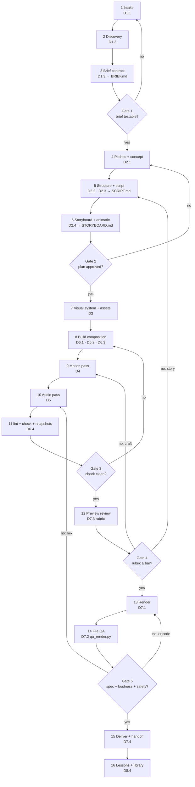

# KB-05 — Skillmap and Gates

*Composite. Part I is Source A — “HyperFrames-Motion-Mastery-Skillgraph” (v1.0, 1 Nov 2026): the seventeen-stage map with inputs, outputs, gates and owning clusters, the process diagram, gate behaviour by mode, scheduling rules and a time budget. Part II is Source B — “HyperFrames-Motion-Mastery” (Claude Code, 1 Nov 2026; CLI lab on hyperframes 0.8.229): the production flow as a pipeline with its validation loop and defaults. The owning-cluster codes in Part I use A's notation — translate with the crosswalk in KB-04 §2.*

*Section numbers inside each part keep the numbering of the source they came from (A = §2–§7 and appendices of the Skillgraph document; B = Parts 3–8 of the Claude Code document). Where the two parts disagree, the preface and KB-14 govern; where either disagrees with the installed CLI, the CLI wins.*

## 0. Gates HyperVideo Man enforces in every mode

User gates — plan approval · board confirmation · render approval (the one question autonomous mode keeps). Self gates — facts verified or labelled · spec quoted verbatim · read-aloud pass · lint 0 errors · check 0 findings with audits run · levels verified and bed carved · ffprobe + ebur128 pass · scorecard and rubric with evidence. Loops — duration sync · lint/check · sketch · review (muted / blind / scrub → weakest scene → revision by timestamp → span re-render) · memory · capability.

## Part I — Source A — “HyperFrames-Motion-Mastery-Skillgraph” (v1.0, 1 Nov 2026)

### 6. The skillmap — the production process with gates and loops

The skillmap is the skillgraph laid along time. It names, for each stage, the skill clusters that run, the artefact that must exist before the next stage starts, the gate that protects it, and the loop that brings findings back. Stages inside a dependency chain are ordered; independent stages run in parallel (audio renders in the background while frames build — "that is the standard trick" [Documented] production-loop.md).

#### 6.1 Stage map

| # | Stage | Clusters | Artefact produced | Gate (who approves) | Loop back to |
|---|---|---|---|---|---|
| 0 | Probe | D1.3e, D8.6f | Version, skill set, usage, credentials noted | — (report) | System prompt if the tool changed |
| 1 | Brief | D1.1, D1.2 | `BRIEF.md` | Hand-off summary confirmed (user; autonomous: stated) | — |
| 2 | Research | D1.3 | Fact list, visual vocabulary, anti-pattern note, gap register | Facts verified or labelled (self) | Brief (if facts change the message) |
| 3 | Direction | D1.4 | `frame.md`, concept, signature move | Preset chosen by eye / spec quoted (user or stated) | Research (brand assets missing) |
| 4 | Script | D2.1, D2.2 | `SCRIPT.md` (locked), word budget | Read-aloud pass; script review stop (user for narrated films) | Direction (tone mismatch) |
| 5 | Storyboard | D3.1, D3.2, D3.4 | `STORYBOARD.md`, music map, cue sheet | **Plan approval** — proposal with frame table (user; autonomous: posted) | Script (beats need different lines) |
| 6 | Expansion | D3.3 | `.hyperframes/expanded-prompt.md` | Spec values quoted; every element has a verb (self) | Storyboard |
| 7 | Sketch | D3.5 | `boards/storyboard.html` + stills | **Board confirmation** (user; skipped in autonomous) | Expansion / Direction (only named frames) |
| 8 | Assets & audio (parallel) | D4.*, D2.3, D7.1–7.3 | `assets/`, manifest, `audio_meta.json` with word timings, BGM, SFX | Candidates judged; generations complete (self) | Storyboard (durations true to voice) |
| 9 | Build frames | D5.*, D6.1–6.4, D6.6 | `compositions/frames/NN-*.html`, variables | lint 0 errors (self) | Expansion (frame deviates from the confirmed still) |
| 10 | Assemble | D5.1, D5.3, D6.5 | `index.html` with sub-comps, transitions injected | lint 0 errors (self) | Build |
| 11 | Captions & sync | D2.4, D7.4, D7.5 | Caption track; placed SFX; carve; automation; limiter | Levels verified (self) | Audio |
| 12 | Verify | D8.1, D8.2 | check report, snapshots, contact sheet, animation map | check 0 findings; passes done (self) | Build / Audio (at the artefact touched) |
| 13 | Final look | D8.3a | Studio preview running | **Render approval** — the one question autonomous mode keeps (user) | Verify |
| 14 | Render & export | D8.3 | MP4/MOV/WebM/…, variants, SRT/VTT, stems | ffprobe + ebur128 pass (self) | Audio (loudness) / Build (frozen frames) |
| 15 | QA & scorecard | D8.4 | 35-item scorecard with evidence | All PASS or listed as unverifiable (self → user) | Revision |
| 16 | Deliver | D8.5 | Package, published link, assumptions list | Visibility explicit; recipe offered once | — |
| 17 | Iterate & learn | D8.6 | Revisions by timestamp; `HANDOFF.md`; recipe; preferences | Weakest scene fixed first | Any stage, at the artefact touched |

#### 6.2 Process diagram

```
 PROBE ─► BRIEF ─► RESEARCH ─► DIRECTION ─► SCRIPT ─► STORYBOARD ══► [PLAN APPROVAL]
   │                                                                     │
   │ (version / skills / usage)                                          ▼
   │                                                                 EXPANSION
   │                                                                     │
   │                                                                     ▼
   │                                                                  SKETCH ══► [BOARD CONFIRMED]
   │                                                                     │
   │                               ┌─────────────────────────────────────┤
   │                               ▼                                     ▼
   │                      ASSETS & AUDIO (background)            BUILD FRAMES
   │                      resolve · generate · TTS · BGM · SFX   contract · motion
   │                               │                                     │
   │                               └──────────► duration sync ◄──────────┘
   │                                                   │
   │                                                   ▼
   │                                               ASSEMBLE ─► CAPTIONS & SYNC ─► VERIFY
   │                                                   ▲                              │
   │                                                   │ findings re-enter here       │
   │                                                   └──────────────────────────────┤
   │                                                                                  ▼
   │                                                                        FINAL LOOK ══► [RENDER APPROVAL]
   │                                                                                  │
   │                                                                                  ▼
   │                                                                   RENDER ─► MEASURE ─► SCORECARD ─► DELIVER
   │                                                                                                       │
   └───────────────────────── HANDOFF.md · recipe · preferences ◄──────────────────────────────────────────┘
                              (feed the next brief)

 ══► = user-facing checkpoint gate (collaborative waits; autonomous posts and continues,
      except RENDER APPROVAL which is always asked)
 ─►  = dependency (ordered)        ◄─ = feedback loop
```

#### 6.3 Gate behaviour by mode [Documented] brief-contract.md § 1

| Gate | Collaborative | Autonomous |
|---|---|---|
| Preference (preset, voice, caption identity) | Ask when the workflow marks it required | Decide and state the choice with a one-line reason |
| Checkpoint (plan, sketches, pre-render review) | Ask and wait | Post the same summary, then continue |
| Quality (fetch completeness, lint, check, verification) | Run and stop on errors | Run and stop on errors |
| Routing ambiguity | Resolve explicitly | Same |
| Sign-in / credential unavailable | Show status and wait | Show status and continue through an available offline provider |
| Render | Ask "render now, or what changes?" | The one kept question |

Autonomous is not silent: every delivery names the artefact, reports the actual duration, and includes a contact sheet or snapshot sheet with frame identifiers so the user has a review surface even though intermediate checkpoints did not pause.

#### 6.4 Scheduling rules (economics you cannot see from inside the session) [Documented] production-loop.md

- External generations (image plates, TTS, BGM, video) are independent work: fire every generation whose prompt is known concurrently or in the background and overlap the wait with reading or building.
- Attaching an image re-prices the whole context: batch visual checks (one contact sheet beats N single-frame views) and schedule them at phase boundaries, not mid-build.
- Install registry blocks once, before any parallel frame work — parallel workers race the registry.
- Write durable decisions to the project files (`BRIEF.md`, `STORYBOARD.md`, `HANDOFF.md`) as they happen; a decision that lives only in chat is a decision resume never sees.

#### 6.5 Time budget for a typical 60-second narrated film (indicative) [Recommended; agent build time Documented]

| Stage | Share | Note |
|---|---|---|
| Brief, research, direction | 15 % | Includes probing the installed version and choosing the preset by eye |
| Script and storyboard (to approval) | 20 % | The cheapest place to change anything — spend here |
| Expansion and sketch board | 10 % | Layout and copy locked before motion |
| Assets, audio, build (parallel) | 30 % | The official guide quotes "about 10 to 15 minutes" of agent time for a launch video; practitioners report longer when AI footage is involved |
| Verify, review passes, fixes | 15 % | Weakest scene first |
| Render, measure, package | 10 % | Local 1080p renders run at seconds-to-tens-of-seconds per 10 s of film depending on workers and content (§2.6) |

## Part II — Source B — “HyperFrames-Motion-Mastery” (Claude Code, 1 Nov 2026; CLI lab on hyperframes 0.8.229)

#### 5.3 Skillmap: the production flow

The skillmap orders the clusters in time. Each stage produces a named artifact; each gate is a pass condition; each loop sends work back to the earliest stage able to fix the problem, never to the latest stage that can hide it.



| # | Stage | Inputs | Output artifact | Main clusters | Exit gate (pass when) | Loops back when |
|---|---|---|---|---|---|---|
| 1 | Intake | Request, links, files | Intent notes, assumption log | D1.1 | Objective, audience, message, constraints known or logged | — |
| 2 | Discovery | Intent notes, URLs, brand files | Research notes, brand tokens, cliché list | D1.2 | Facts sourced; brand tokens extracted; rights known | A claim cannot be verified → Intake |
| 3 | Brief contract | All of the above | `BRIEF.md` | D1.3, D8.2 | Gate 1: every field filled or defaulted; acceptance criteria testable | Gate 1 fails → Intake |
| 4 | Concept | `BRIEF.md` | 3+ pitches, chosen concept | D2.1 | Concept beats the cliché list and fits the brief | — |
| 5 | Structure + script | Concept | Beat sheet, `SCRIPT.md` | D2.2, D2.3 | Hook in first seconds; word budget fits duration | Timing overruns → cut copy, not speed up VO |
| 6 | Storyboard + animatic | Script | `STORYBOARD.md`, key frames, animatic timing | D2.4 | Gate 2: every beat has a frame, duration, transition and audio cue | Gate 2 fails → Concept or Script |
| 7 | Visual system + assets | Board, brand tokens | Design spec, prepared assets | D3 | Tokens defined; assets licensed and at resolution | Asset gap → Discovery |
| 8 | Build | Spec, assets | `index.html`, `compositions/*.html` | D6.1–D6.3 | Lint clean; timeline matches board | — |
| 9 | Motion pass | Built scenes | Animated timelines | D4 | Motion budget respected; easing and rhythm consistent | — |
| 10 | Audio pass | VO, music, SFX | Placed and mixed tracks, captions | D5 | VO intelligible; beats aligned; captions timed | — |
| 11 | Verify | Project | `check` report, snapshots | D6.4 | Gate 3: `check` passes with no persistent findings | Findings → Build |
| 12 | Review | Preview, snapshots | Rubric scorecard | D7.3, D8.3 | Gate 4: every rubric dimension at or above the bar | Craft gap → Motion; story gap → Script |
| 13 | Render | Approved project | Video file(s) | D7.1 | Render completes at target spec | Failure → diagnosis (D7.1d) |
| 14 | File QA | Rendered file | QA report, contact sheet | D7.2 | Gate 5: spec, loudness, flash and caption checks pass | Mix fail → Audio; encode fail → Render |
| 15 | Deliver | Approved files | Platform packages, handoff notes | D7.4 | Every platform version, caption file and licence included | — |
| 16 | Learn | Run history | Lessons, reusable blocks | D8.4 | One reusable lesson or block recorded | — |

**Mapping to the official HyperFrames workflow.** When the official skills are installed, the same stages run inside HeyGen's own pipeline, whose shape depends on the skill generation installed. In the 21-skill generation installed on this machine (2026-10-21), the intent interview ends by writing `BRIEF.md`, the only routing artifact, and a router picks one of ten workflow skills; `SCRIPT.md` and `STORYBOARD.md` hold narration and plan; the review loop covers plan, sketch and build [DOC] [S-09]. Upstream retired those workflow skills in v0.8.185 (2026-10-21) and folded their guidance into the `/hyperframes` references (format, runtimes, motion, look, film, story, spec, review, captions, overlays, sound, storyboard), keeping the same planning files and adding `SPEC.md` and `REVIEW.md` [DOC] [A1-37] [A1-32]. In every generation `npx hyperframes check` is the final gate before render [DOC] [S-10] [A1-35]. This skillgraph does not replace that pipeline. It adds the director's judgment to each stage: what a strong brief contains, how to choose among pitches, what the rubric demands, and how to diagnose a weak result.
